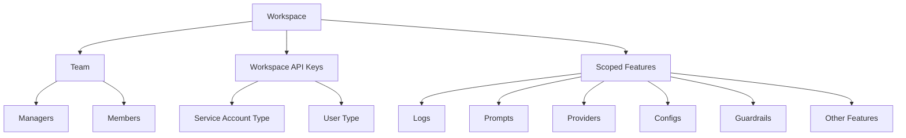

## Workspaces

Workspaces in Prisma AIRS AI Gateway are sub-organisations that enable better separation of data, teams, scope, and visibility within your larger organisation.

They provide a more granular level of control and organisation, allowing you to structure your projects and teams efficiently.

Key features of Workspaces:

* **Team Management:** You can add team members to workspaces with specific roles (manager or member), allowing for precise access control.
* **Dedicated API Keys:** Workspaces contain their own API keys, which can be of two types:
   * Service Account type: For automated processes and integrations
   * User type: For individual user access
   * Both these types of keys are scoped to the workspace by default and can only execute actions within that workspace.
* **Completion API Scoping:** Completion APIs are always scoped by workspace and can only be accessed using workspace API keys.
* **Admin Control:** While only org admins can create workspaces, managers can add API keys and team members with roles to existing workspaces.
* **Flexible Updates:** When you change entities with an organisation-level access token, pass `workspace_id` to say which workspace you're changing. It's the workspace's UUID, not its slug. See [Workspace IDs](#workspace-ids).

Workspaces provide a powerful way to organize your projects, teams, and resources within your larger organisation, ensuring proper access control and data separation.

This structure allows for efficient management of resources and access within each workspace, providing a clear separation between different projects or teams within your organisation.

### Workspace IDs

Every workspace has two identifiers:

| Identifier | Example | Where it's used |
|:--|:--|:--|
| **Slug** | The short name you gave the workspace | Shown in Strata Cloud Manager |
| **ID** (UUID) | `a1b2c3d4-e5f6-7890-abcd-ef1234567890` | The `workspace_id` parameter on the [Admin API](/aigw/api-reference/admin-api/introduction#how-resources-are-scoped) |

Admin API calls that act on a workspace, such as configs, providers, guardrails and analytics, require `workspace_id`, and it must be the UUID. A slug isn't accepted there.

To find a workspace's UUID:

- Call [`GET /workspaces`](/aigw/api-reference/workspaces/list-workspaces) on the Workspace Service (`https://api.sase.paloaltonetworks.com/airs/workspace/v1`) with your access token, filtered by `exact_name`. The `id` field of each result is the UUID.
- Or open the workspace in Strata Cloud Manager and copy the UUID from the page URL.

The Workspace Service also [creates](/aigw/api-reference/workspaces/create-workspace), [gets](/aigw/api-reference/workspaces/get-workspace) and [updates](/aigw/api-reference/workspaces/update-workspace) workspaces. A workspace is bound to a Strata Cloud Manager scope: create the scope first, then pass its name as `scope_name` when you create the workspace.

### Deleting a Workspace

<Note>
- Before deleting a workspace, all resources within it must be removed.
- You can't delete the default Shared Team Workspace.
</Note>

To delete a workspace in the AI Gateway, follow these steps:

1. Navigate to the sidebar in Strata Cloud Manager
2. Open the workspace menu dropdown
3. Select the workspace you wish to delete
4. Click on the delete option (trash icon) next to the workspace name

When attempting to delete a workspace, you'll receive a confirmation dialog. If the workspace still contains resources, you'll see a warning message prompting you to delete these resources first.

Resources that must be deleted before removing a workspace like - Prompts, Prompt partials, Providers, Configs, Guardrails and more.

Once all resources have been removed, enter the workspace name in the confirmation field to proceed with deletion.

<Warning>
  Workspace deletion is permanent and cannot be undone
</Warning>

### Related Topics

<Card title="Organisations" href="/aigw/product/enterprise-offering/org-management/organizations"/>
<Card title="User Roles & Permissions" href="/aigw/product/enterprise-offering/org-management/user-roles-and-permissions"/>
<Card title="API Keys (AuthN and AuthZ)" href="/aigw/product/enterprise-offering/org-management/api-keys-authn-and-authz"/>
