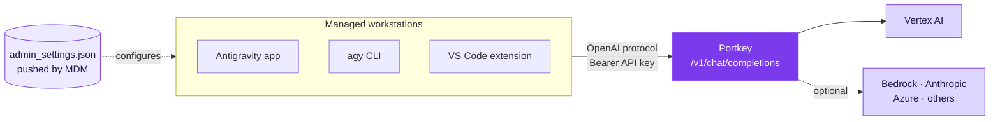

[Antigravity Enterprise Gateway](https://docs.cloud.google.com/gemini/enterprise/docs/ai-developer-tools/deploy-enterprise-gateway) lets Google Antigravity send its model traffic to a gateway your organization runs, instead of straight to Google. Point it at Portkey, switch it to the OpenAI wire protocol, and every prompt, agent step and tool call from every workstation flows through one governed gateway.

Configuration ships as a single `admin_settings.json` file pushed by your MDM. Developers install Antigravity, open it, and start working. No Google sign-in, no keys to paste.

When you're done:

- Antigravity connects to Portkey with no interactive Google sign-in
- Developers pick only from the models you approve
- Budgets, rate limits and guardrails apply to every request
- Every request is logged and attributed to a team, cost center or developer
- Fallbacks keep developers working when a provider has an outage



## How it works

In gateway mode, Antigravity stops talking to Google. It sends every inference request to the URL in `gateway.url`, authenticates with the key in `gateway.apiKey`, and adds any headers you list in `gateway.customHeaders`.

With `"wireProtocol": "openai"`, those requests are standard OpenAI Chat Completions calls, which Portkey serves natively:

| Antigravity sends | Portkey |
|---|---|
| `POST {gateway.url}/v1/chat/completions` | Portkey's [universal API](/product/ai-gateway/universal-api) endpoint |
| `Authorization: Bearer <key>` | Accepted as the Portkey API key |
| `gateway.customHeaders` on every request | Read as Portkey headers, such as `x-portkey-config` and `x-portkey-metadata` |
| Streaming responses over SSE | Streamed back chunk by chunk |

Portkey then calls the provider with the credentials stored in [Model Catalog](/product/model-catalog). No Google Cloud credentials ever reach a workstation.

## Supported clients

| Client | Minimum version | Through Portkey |
|---|---|---|
| Antigravity app | 2.15.0 | <Icon icon="check" /> macOS, Windows, Linux |
| Antigravity CLI (`agy`) | 1.2.15 | <Icon icon="check" /> macOS, Linux |
| VS Code and Visual Studio extensions | CLI 1.2.15, downloaded by the extension | <Icon icon="check" /> |
| JetBrains IDEs and Zed | 1.3.0 | <Icon icon="xmark" /> |
| Antigravity on the web | | <Icon icon="xmark" /> |

<Warning>
JetBrains IDEs and Zed run Antigravity through its ACP server, which supports only the Gemini (`genai`) wire protocol. Portkey doesn't serve `genai`, and when `admin_settings.json` sets `"wireProtocol": "openai"`, those sessions fail with `gateway.wireProtocol 'openai' is not supported by the ACP server`. Antigravity on the web has no gateway mode and always requires Google sign-in.
</Warning>

## Prerequisites

| Requirement | Notes |
|---|---|
| Portkey workspace | Admin access to create providers, configs and API keys |
| A model provider | Vertex AI for Gemini models. Any provider for other models |
| An MDM system | Jamf, Microsoft Intune, Ansible, Google Workspace MDM or similar |
| Supported Antigravity clients | See [Supported clients](#supported-clients) |

## 1. Add a provider

Connect the account Portkey will call on behalf of your developers. For Gemini models, that's Vertex AI with a service account that has the `roles/aiplatform.user` role.

Go to [Model Catalog](https://app.portkey.ai/model-catalog) → **Add Provider**.

<CardGroup cols={3}>
  <Card title="Vertex AI" icon="google" href="/integrations/llms/vertex-ai">
    Gemini through Google Cloud
  </Card>
  <Card title="Gemini API" icon="sparkles" href="/integrations/llms/gemini">
    Google AI Studio keys
  </Card>
  <Card title="AWS Bedrock" icon="aws" href="/integrations/llms/bedrock/aws-bedrock">
    Claude and more on AWS
  </Card>
</CardGroup>

This guide uses a Vertex AI provider with the slug `@vertex-prod`.

## 2. Create a config

The config decides where Antigravity's requests go. Developers never see it, and you can change it without touching a single workstation.

Go to [Configs](https://app.portkey.ai/configs) → **Create Config**:

```json
{
  "provider": "@vertex-prod"
}
```

With the provider pinned here, Antigravity can use plain Gemini model IDs such as `gemini-3.8-flash`.

<AccordionGroup>
  <Accordion title="Fail over to a second region or project" icon="life-ring">
    Keep developers working through a regional outage or quota exhaustion:

    ```json
    {
      "strategy": { "mode": "fallback", "on_status_codes": [429, 500, 502, 503] },
      "targets": [
        { "provider": "@vertex-prod" },
        { "provider": "@vertex-prod-eu" }
      ]
    }
    ```

    See [Fallbacks](/product/ai-gateway/fallbacks).
  </Accordion>

  <Accordion title="Scan prompts and responses with guardrails" icon="shield-check">
    Attach input and output guardrails to block secrets, PII or prompt injection before it reaches the model:

    ```json
    {
      "provider": "@vertex-prod",
      "input_guardrails": ["pg-secrets-xxx"],
      "output_guardrails": ["pg-pii-xxx"]
    }
    ```

    Coding agents resend the full conversation on every turn. Prefer guardrails that block or flag over ones that rewrite content, so the history stays consistent. See [Guardrails](/product/guardrails).
  </Accordion>
</AccordionGroup>

## 3. Create an API key

Go to [API Keys](https://app.portkey.ai/api-keys) and create a key for Antigravity. Attach the config from step 2, then add the controls you want enforced on every request:

<CardGroup cols={3}>
  <Card title="Budget Limits" icon="coins" href="/product/model-catalog/budget-limits">
    Cap spend per key
  </Card>
  <Card title="Rate Limits" icon="gauge-high" href="/product/model-catalog/rate-limits">
    Cap requests or tokens per minute
  </Card>
  <Card title="Guardrails" icon="shield-check" href="/product/guardrails">
    Enforce content policy
  </Card>
</CardGroup>

<Tip>
One shared key is the fastest rollout. One key per developer gives per-person budgets and attribution. See [Per-developer keys](#per-developer-keys).
</Tip>

## 4. Test the route

Before touching a workstation, confirm that Portkey answers the exact request Antigravity will make:

```bash
curl -N https://api.portkey.ai/v1/chat/completions \
  -H "Authorization: Bearer $PORTKEY_API_KEY" \
  -H "Content-Type: application/json" \
  -d '{
    "model": "gemini-3.8-flash",
    "stream": true,
    "messages": [{ "role": "user", "content": "Reply with PONG" }]
  }'
```

Chunks should arrive one by one, and the request should appear in [Logs](https://app.portkey.ai/logs) within seconds. Run the same test with every model you plan to list in step 5.

## 5. Write `admin_settings.json`

```json admin_settings.json
{
  "gateway": {
    "enabled": true,
    "url": "https://api.portkey.ai",
    "apiKey": "YOUR_PORTKEY_API_KEY",
    "wireProtocol": "openai",
    "customHeaders": {
      "x-portkey-metadata": "{\"client\":\"antigravity\",\"team\":\"platform-engineering\"}"
    }
  },
  "models": {
    "defaultModelId": "gemini-3.8-flash",
    "list": [
      { "modelId": "gemini-3.8-flash" },
      { "modelId": "gemini-3.7-flash" },
      { "modelId": "gemini-3.1-pro-preview" }
    ]
  }
}
```

| Field | What to set |
|---|---|
| `gateway.enabled` | `true`. Antigravity routes all inference to the gateway and skips Google sign-in |
| `gateway.url` | `https://api.portkey.ai`, or your self-hosted gateway URL. Leave off `/v1`; Antigravity appends `/v1/chat/completions` |
| `gateway.apiKey` | The Portkey API key from step 3. Omit it to use [per-developer keys](#per-developer-keys) |
| `gateway.wireProtocol` | `openai`. Required: Portkey doesn't serve Antigravity's default Gemini (`genai`) protocol |
| `gateway.customHeaders` | Portkey headers sent on every request. [Metadata](/product/observability/metadata) here tags every log for filtering, analytics and policy |
| `models.defaultModelId` | The model selected when Antigravity opens |
| `models.list` | The only models developers can pick. Each `modelId` must resolve through your config |
| `caCertPath` | Self-hosted gateways with a private CA only. Absolute path to your root CA bundle |

<Note>
Settings in `admin_settings.json` take precedence over environment variables and the developer's own `~/.antigravity/settings.json`, merged field by field. Anything you set here, including the metadata header, can't be overridden on the workstation.
</Note>

### Offer models from more than one provider

Drop `provider` from the config and use [Model Catalog](/product/model-catalog) slugs as model IDs. Each entry then names its own provider:

```json
"models": {
  "defaultModelId": "@vertex-prod/gemini-3.8-flash",
  "list": [
    { "modelId": "@vertex-prod/gemini-3.8-flash" },
    { "modelId": "@vertex-prod/gemini-3.1-pro-preview" },
    { "modelId": "@bedrock-prod/us.anthropic.claude-sonnet-4-5-20250929-v1:0" }
  ]
}
```

Antigravity's agent is built and tuned for Gemini. Pilot other models with a small group before listing them for everyone.

## 6. Deploy with MDM

Antigravity reads the file from a fixed, admin-owned path on each operating system. Ship it with your MDM as a script or package that runs with administrator privileges, so developers can read the file but not edit it.

<Tabs>
  <Tab title="macOS">
    Path: `/Library/Application Support/Antigravity/admin_settings.json`

    ```bash
    sudo mkdir -p "/Library/Application Support/Antigravity"
    sudo install -m 644 -o root -g wheel admin_settings.json \
      "/Library/Application Support/Antigravity/admin_settings.json"
    ```
  </Tab>
  <Tab title="Linux">
    Path: `/etc/antigravity/admin_settings.json`

    ```bash
    sudo install -D -m 644 -o root -g root admin_settings.json \
      /etc/antigravity/admin_settings.json
    ```
  </Tab>
  <Tab title="Windows">
    Path: `%ProgramData%\Antigravity\admin_settings.json`

    Run in PowerShell as an administrator:

    ```powershell
    $dir = Join-Path $env:ProgramData "Antigravity"
    # Remove any folder a non-admin created first, so they can't keep ownership.
    if (Test-Path $dir) { Remove-Item -Recurse -Force $dir }
    New-Item -ItemType Directory -Path $dir | Out-Null
    # Administrators own the folder; only admins and SYSTEM can write; users can read.
    icacls $dir /setowner "*S-1-5-32-544"
    icacls $dir /inheritance:r /grant:r "*S-1-5-32-544:(OI)(CI)F" "*S-1-5-18:(OI)(CI)F" "*S-1-5-32-545:(OI)(CI)RX"
    Copy-Item admin_settings.json (Join-Path $dir "admin_settings.json")
    ```
  </Tab>
</Tabs>

Assign the package to the device groups that use Antigravity, then restart Antigravity on those machines so it loads the file.

## 7. Verify

<Steps>
  <Step title="Antigravity app">
    The status bar shows **Connected: Enterprise Gateway**, and **Account Settings** shows **Enterprise Gateway Mode Active**.
  </Step>
  <Step title="Antigravity CLI">
    ```bash
    agy -p "Explain binary search in Go"
    ```

    The answer streams in the terminal with no Google sign-in prompt.
  </Step>
  <Step title="Portkey">
    Open [Logs](https://app.portkey.ai/logs) and filter by `client = antigravity`. Each request shows the model, tokens, cost, latency and any guardrail verdicts.
  </Step>
</Steps>

## Per-developer keys

A shared key in `admin_settings.json` attributes usage to the team. To see and limit usage per person, give each developer their own key:

1. Create one Portkey API key per developer, each with the Antigravity config attached and its own budget.
2. Remove `gateway.apiKey` from `admin_settings.json`. Keep everything else there.
3. Set `AGY_LLM_GATEWAY_API_KEY` on each workstation, per user, through your MDM or secrets tooling.

Because settings merge field by field, Antigravity takes the URL, protocol, headers and models from the admin file and the key from the environment.

## Sandboxes and CI

Containers, remote SSH hosts and CI runners don't have an MDM-managed file. Configure them with environment variables or `~/.antigravity/settings.json` using the same `gateway` block, and set the protocol explicitly:

```bash
export AGY_LLM_GATEWAY_API_KEY="YOUR_PORTKEY_API_KEY"
export AGY_LLM_GATEWAY_WIRE_PROTOCOL="openai"
```

Use a dedicated key with its own budget for each pipeline so automated runs never spend from a developer's allowance. Google's [Connect Antigravity to an Enterprise Gateway](https://docs.cloud.google.com/gemini/enterprise/docs/ai-developer-tools/connect-enterprise-gateway) guide lists every environment variable.

## Security

The Portkey API key sits on the workstation in plain text. Treat it as a scoped, revocable credential and limit what it can do:

- **Scope the key.** Attach a config, a budget and a rate limit so a leaked key can only reach approved models and spend a capped amount.
- **Rotate it.** Issue a new key, push an updated `admin_settings.json`, then revoke the old key.
- **Pin attribution in the admin file.** Headers set through `AGY_LLM_GATEWAY_HEADERS` or the user settings file can be changed by the developer. Only `customHeaders` in `admin_settings.json` is tamper-proof from the workstation.
- **Keep the network private.** With a [self-hosted gateway](/self-hosting/hybrid-deployments/architecture), expose it only on your corporate network and set `caCertPath` if it uses an internal CA.

## Troubleshooting

| Symptom | Fix |
|---|---|
| Antigravity asks for Google sign-in | The file isn't at the OS path, or `gateway.enabled` isn't `true`. Check the path and restart Antigravity. |
| Requests fail on `/v1beta/models/...` paths | `wireProtocol` is `genai` or unset. Set it to `openai`. |
| `401 Unauthorized` | The API key is wrong or revoked. Check `gateway.apiKey` or `AGY_LLM_GATEWAY_API_KEY`. |
| `404` or model not found | The `modelId` doesn't resolve. Check the provider in the config, or use a `@provider/model` slug. |
| `gateway.wireProtocol 'openai' is not supported by the ACP server` | The developer is on JetBrains or Zed. Use the app, CLI or VS Code extension. |
| `x509: certificate signed by unknown authority` | Self-hosted gateway with a private CA. Set `caCertPath` to your root CA bundle. |
| Streams stall or cut off on a self-hosted gateway | Disable response buffering for `text/event-stream` on your load balancer and allow requests to run for at least 60 minutes. |
| Requests start failing after working earlier | A budget or rate limit on the key was reached. Check the key's limits in Portkey. |

## Next steps

<CardGroup cols={2}>
  <Card title="Configs" icon="sliders" href="/product/ai-gateway/configs">
    Routing, fallbacks, caching and retries
  </Card>
  <Card title="Guardrails" icon="shield-check" href="/product/guardrails">
    Inspect every prompt and response
  </Card>
  <Card title="Metadata" icon="tags" href="/product/observability/metadata">
    Attribute usage to teams and developers
  </Card>
  <Card title="Antigravity Enterprise Gateway" icon="arrow-up-right-from-square" href="https://docs.cloud.google.com/gemini/enterprise/docs/ai-developer-tools/deploy-enterprise-gateway">
    Google's deployment reference
  </Card>
</CardGroup>

import PrismaAirsCta from "/snippets/prisma-airs-cta.mdx";

<PrismaAirsCta />
