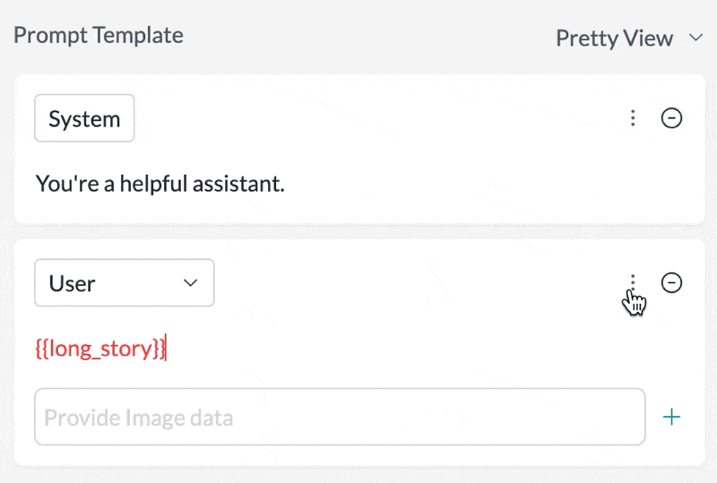
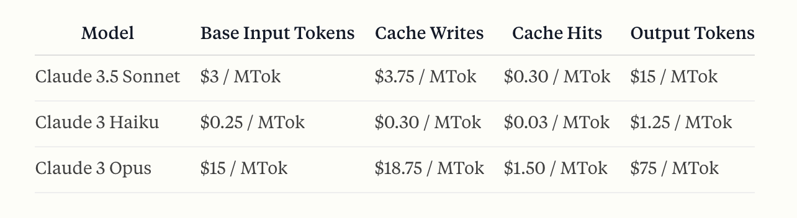
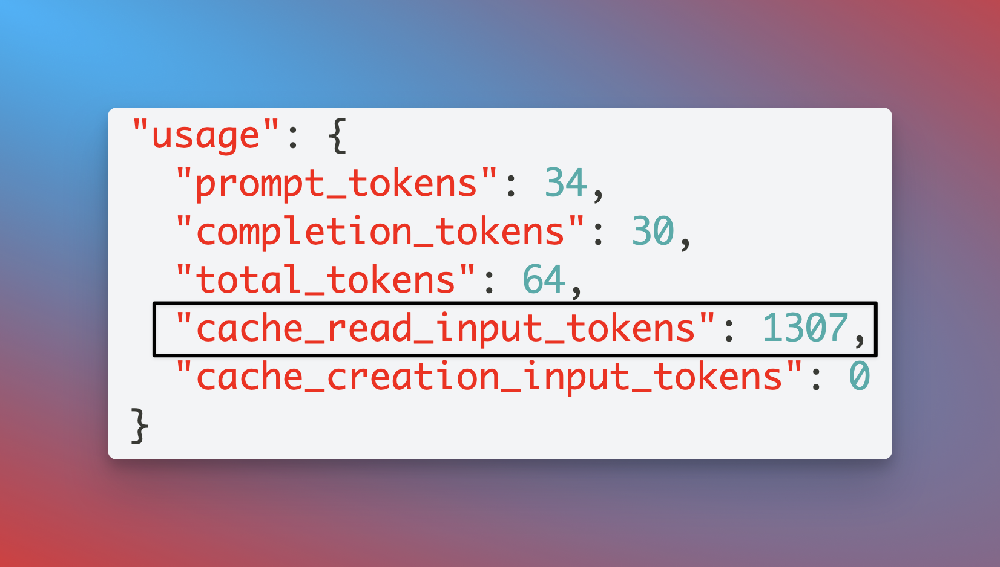

Prompt caching on Anthropic lets you cache individual messages in your request for repeat use. With caching, you can free up your tokens to include more context in your prompt, and also deliver responses significantly faster and cheaper.

You can use this feature on our OpenAI-compliant universal API as well as with our prompt templates.

## API Support

Just set the `cache_control` param in your respective message body:

<CodeGroup>

```javascript NodeJS
import Portkey from 'portkey-ai'

const portkey = new Portkey({
    apiKey: "PORTKEY_API_KEY", // defaults to process.env["PORTKEY_API_KEY"]
    provider:"@PROVIDER"
})

const chatCompletion = await portkey.chat.completions.create({
    messages: [
        { "role": 'system', "content": [
            {
                "type":"text","text":"You are a helpful assistant"
            },
            {
                "type":"text","text":"<TEXT_TO_CACHE>",
                "cache_control": {"type": "ephemeral"}
            }
        ]},
        { "role": 'user', "content": 'Summarize the above story for me in 20 words' }
    ],
    model: 'claude-3-5-sonnet-20240620',
    max_tokens: 250 // Required field for Anthropic
});

console.log(chatCompletion.choices[0].message.content);
```

```python Python
from portkey_ai import Portkey

portkey = Portkey(
    api_key="PORTKEY_API_KEY",
    provider="@ANTHROPIC_PROVIDER",
)

chat_completion = portkey.chat.completions.create(
    messages= [
        { "role": 'system', "content": [
            {
                "type":"text","text":"You are a helpful assistant"
            },
            {
                "type":"text","text":"<TEXT_TO_CACHE>",
                "cache_control": {"type": "ephemeral"}
            }
        ]},
        { "role": 'user', "content": 'Summarize the above story in 20 words' }
    ],
    model= 'claude-3-5-sonnet-20240620',
    max_tokens=250
)

print(chat_completion.choices[0].message.content)
```

```javascript OpenAI NodeJS
import OpenAI from "openai";
import { PORTKEY_GATEWAY_URL, createHeaders } from "portkey-ai";

const portkey = new OpenAI({
    apiKey: "ANTHROPIC_API_KEY",
    baseURL: PORTKEY_GATEWAY_URL,
    defaultHeaders: createHeaders({
        provider: "anthropic",
        apiKey: "PORTKEY_API_KEY",
  }),
});

const chatCompletion = await portkey.chat.completions.create({
    messages: [
        { "role": 'system', "content": [
            {
                "type":"text","text":"You are a helpful assistant"
            },
            {
                "type":"text","text":"<TEXT_TO_CACHE>",
                "cache_control": {"type": "ephemeral"}
            }
        ]},
        { "role": 'user', "content": 'Summarize the above story for me in 20 words' }
    ],
    model: 'claude-3-5-sonnet-20240620',
    max_tokens: 250
});

console.log(chatCompletion.choices[0].message.content);
```

```python OpenAI Python
from openai import OpenAI
from portkey_ai import PORTKEY_GATEWAY_URL, createHeaders

client = OpenAI(
    api_key="ANTHROPIC_API_KEY",
    base_url=PORTKEY_GATEWAY_URL,
    default_headers=createHeaders(
        api_key="PORTKEY_API_KEY",
        provider="anthropic",
    )
)

chat_completion = portkey.chat.completions.create(
    messages= [
        { "role": 'system', "content": [
            {
                "type":"text","text":"You are a helpful assistant"
            },
            {
                "type":"text","text":"<TEXT_TO_CACHE>",
                "cache_control": {"type": "ephemeral"}
            }
        ]},
        { "role": 'user', "content": 'Summarize the above story in 20 words' }
    ],
    model= 'claude-3-5-sonnet-20240620',
    max_tokens=250
)

print(chat_completion.choices[0].message.content)
```

```sh REST API
curl https://api.portkey.ai/v1/chat/completions \
  -H "Content-Type: application/json" \
  -H "Authorization: Bearer $ANTHROPIC_API_KEY" \
  -H "x-portkey-api-key: $PORTKEY_API_KEY" \
  -H "x-portkey-provider: anthropic" \
  -d '{
    "model": "claude-3-5-sonnet-20240620",
    "max_tokens": 1024,
    "messages": [
        { "role": "system", "content": [
            {
                "type":"text","text":"You are a helpful assistant"
            },
            {
                "type":"text","text":"<TEXT_TO_CACHE>",
                "cache_control": {"type": "ephemeral"}
            }
        ]},
        { "role": "user", "content": "Summarize the above story for me in 20 words" }
    ]
  }'
```

</CodeGroup>

## Prompt Templates Support

Set any message in your prompt template to be cached by just toggling the `Cache Control` setting in the UI:

<Frame>
  
</Frame>

## Cache TTL Options

By default, the cache has a **5-minute** lifetime that refreshes each time cached content is used. You can optionally specify a **1-hour** TTL by adding the `ttl` field to `cache_control`:

```json
{
  "cache_control": { "type": "ephemeral", "ttl": "1h" }
}
```

| TTL | Write Cost | Best For |
|-----|-----------|----------|
| `5m` (default) | 1.25x base input price | Prompts used more frequently than every 5 minutes |
| `1h` | 2x base input price | Agentic workflows, long conversations where follow-ups may exceed 5 minutes |

Cache reads cost 0.1x the base input token price regardless of TTL.

<Note>
- The message you are caching needs to cross minimum length to enable this feature (1024 tokens for Claude 3.5 Sonnet and Claude 3 Opus, 2048 tokens for Claude 3 Haiku)
- You can mix both TTLs in the same request, but 1-hour entries must appear before 5-minute entries
- Up to 4 cache breakpoints per request
</Note>

For more, refer to Anthropic's prompt caching documentation [here](https://docs.anthropic.com/en/docs/build-with-claude/prompt-caching).

## Automatic Caching

Instead of marking individual messages, you can have the gateway turn on Anthropic's automatic caching for every request by setting `auto_caching` to `true` in your [Config](/product/ai-gateway/configs):

```json
{
  "provider": "@anthropic-provider",
  "auto_caching": true
}
```

The gateway adds a top-level `cache_control: { "type": "ephemeral" }` to the request, and Anthropic places the cache breakpoint on the last cacheable block. A `cache_control` you set on the request yourself is kept as is. `auto_caching` is inherited by nested targets and can be overridden on a target.

### When to use it

`auto_caching` is for requests where the **client never sends `cache_control` markers of its own**:

- **Clients you don't control the request body for** — OpenAI-compatible SDKs, internal applications, and anything that has no way to express Anthropic's cache markers.
- **Codex and other Responses API clients.** Codex calls `/v1/responses`, which the gateway converts internally before sending it to Claude. The Responses API has no `cache_control` field, so the client cannot request caching at all — `auto_caching` injects the marker on that converted request for you.
- **Clients where you also want to control the TTL.** Combine `auto_caching` with `default_params` to set a 1-hour cache without touching the client. See [Controlling the TTL](#controlling-the-ttl).

If your client already sends its own block-level markers — Claude Code is the common case — read [Clients that send their own cache markers](#clients-that-send-their-own-cache-markers) before enabling this.

### Supported providers and endpoints

The endpoint column is the route **your client calls on the gateway**. Requests to `/v1/responses` are converted to chat completions internally before reaching Claude.

| Provider | `/v1/messages` | `/v1/chat/completions` | `/v1/responses` |
| --- | --- | --- | --- |
| Anthropic | Yes | Yes | Yes |
| Claude Platform on AWS | Yes | Yes | Yes |
| Google Vertex AI | Yes | Yes | Yes |
| Azure AI Foundry | Yes | Yes <sup>1</sup> | Yes <sup>1</sup> |
| Amazon Bedrock | Yes (InvokeModel) | No (Converse) | No |
| Bedrock Mantle | Yes <sup>2</sup> | No | No <sup>3</sup> |

<sup>1</sup> Anthropic deployments only — the gateway uses Claude's request format when the Foundry deployment URL identifies an Anthropic model.
<sup>2</sup> `anthropic.*` models only. Mantle also serves non-Claude models, which are skipped.
<sup>3</sup> Bedrock Mantle serves the Responses API natively, so the request is not converted and no marker is injected.

Where a cell says No, the request still succeeds — it is simply sent without a top-level `cache_control`.

<Note>
Sending the `x-portkey-beta: use-responses-api-2026-07-30` header with a `/v1/responses` request keeps it on the provider's native Responses API instead of converting it. No `cache_control` is injected on that path for any provider, and providers without a native Responses endpoint return an error. Leave the header off if you want automatic caching.
</Note>

<Warning>
`auto_caching` is opt-in per config, not an organization-wide default. Before turning it on broadly, consider:

- **One-shot traffic can cost more.** The cache marker goes after the last block of the request. If your prompt ends in content that is unique to each request, every request pays the 1.25x cache write price and never gets a cache hit. It saves money on multi-turn chats and agent loops.
- **Anthropic can return a 400** if the client already uses all 4 explicit cache breakpoints, or has a `cache_control` on the last block with a different TTL than the automatic one. Requests without cache markers are not affected, so the risk is clients that mix their own markers with `auto_caching`.
</Warning>

### Controlling the TTL

`auto_caching` on its own uses Anthropic's default 5-minute TTL. To cache with a 1-hour TTL, set the top-level `cache_control` through `default_params`:

```json
{
  "provider": "@anthropic-provider",
  "auto_caching": true,
  "default_params": {
    "cache_control": { "type": "ephemeral", "ttl": "1h" }
  }
}
```

A 1-hour cache write costs 2x the base input token price, against 1.25x for 5 minutes. Cache reads cost 0.1x at either TTL.

- Pass `cache_control` as an object. The gateway forwards it unchanged, so the string `"ephemeral"` would reach Anthropic as a plain string.
- Use `default_params` rather than `override_params`. `default_params` only fills in `cache_control` when the request doesn't already have one, while `override_params` always overwrites a `cache_control` the client sent deliberately.  See [Default and drop params](/product/ai-gateway/configs#default-and-drop-params).
- `default_params` works on `/v1/messages` for every provider in the table above, including Bedrock Mantle's non-Claude models. On `/v1/chat/completions` and `/v1/responses` it is carried only by the providers marked Yes in that column; elsewhere the value is dropped and the request is sent uncached.

### Clients that send their own cache markers

Some clients place `cache_control` markers on individual blocks themselves. **Claude Code** does this on every request — it marks `system` blocks, tool definitions, and `messages` entries, including the `role: "system"` entries it appends mid-conversation. It never sends a top-level `cache_control`, so `auto_caching` will add one *on top of* its markers.

<Warning>
Anthropic allows a maximum of **4 cache breakpoints per request**, and the automatic marker consumes one of them. If Claude Code is already using all four, the gateway's injected marker makes five and Anthropic returns a **400**. A marker on the last block with a TTL different from the injected one also returns a 400.

Claude Code recovers from this by retrying once with the marker moved onto the last conversation message and keeping it there until it exits, so sessions are not broken — but the affected block is billed as uncached input for the rest of the session.
</Warning>

You have two options.

**Option 1 — Keep Claude Code's own caching (recommended).** Leave `auto_caching` off for configs serving Claude Code. Its markers pass through unchanged, and the TTL is configured in the client with the [`promptCacheTtl`](https://code.claude.com/docs/en/settings-reference#promptcachettl) and [`subagentPromptCacheTtl`](https://code.claude.com/docs/en/settings-reference#subagentprompt-cache-ttl) settings, or the `ENABLE_PROMPT_CACHING_1H` environment variable. Claude Code places its breakpoints at stable prefix boundaries, which is usually better tuned than a single automatic breakpoint.

**Option 2 — Switch to top-level caching controlled by the gateway.** If you want the TTL decided centrally rather than per developer machine, strip the client's block-level markers with `drop_params` so the injected top-level marker is the only one left:

```json
{
  "provider": "@anthropic-provider",
  "auto_caching": true,
  "default_params": {
    "cache_control": { "type": "ephemeral", "ttl": "1h" }
  },
  "drop_params": [
    "system[*].cache_control",
    "messages[*].cache_control",
    "messages[*].content[*].cache_control",
    "tools[*].cache_control"
  ]
}
```

All four paths are required — omitting `messages[*].cache_control` leaves the marker on mid-conversation `role: "system"` entries. With no block markers left, neither 400 case can occur. Drop `default_params` from the example to use the 5-minute TTL instead.

<Note>
With `drop_params` in place, the client's own TTL settings no longer have any effect, because the TTL lives inside the markers being removed. A developer who sets `ENABLE_PROMPT_CACHING_1H` will still get whatever the config specifies. The gateway becomes the only place the TTL is set, so use separate configs or targets if different teams need different TTLs.
</Note>


## Seeing Cache Results in Portkey

Portkey automatically calculates the correct pricing for your prompt caching requests & responses based on Anthropic's calculations here:

<Frame>
  
</Frame>

In the individual log for any request, you can also see the exact status of your request and verify if it was cached, or delivered from cache with two `usage` parameters:

* `cache_creation_input_tokens`: Number of tokens written to the cache when creating a new entry.
* `cache_read_input_tokens`: Number of tokens retrieved from the cache for this request.

<Frame>
  
</Frame>

<Info>
**Understanding Token Counts with Caching**

Portkey normalizes Anthropic's response to the OpenAI format. In this format, `prompt_tokens` **includes** the cached tokens:

```
prompt_tokens = inputTokens + cache_read_input_tokens + cache_creation_input_tokens
```

This differs from Anthropic's native format where `inputTokens` excludes cached tokens. Portkey's pricing calculation accounts for this by:
1. Subtracting cached tokens from `prompt_tokens` to get the base input token count
2. Applying the standard input token rate to base tokens
3. Applying the discounted cache read rate to `cache_read_input_tokens`
4. Applying the cache write rate to `cache_creation_input_tokens`

This ensures accurate cost calculation even though the token format is normalized.
</Info>


import PrismaAirsCta from "/snippets/prisma-airs-cta.mdx";

<PrismaAirsCta />
