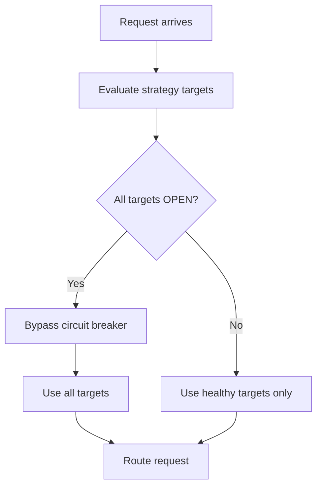

<Info>
Available on all Portkey [plans](https://portkey.ai/pricing).
</Info>

Circuit breakers prevent cascading failures by temporarily blocking requests to targets that are failing.

<Note>
Circuit breakers react to failures only. They do not manage concurrency. See [Circuit Breakers and Concurrency](#circuit-breakers-and-concurrency).
</Note>

## Config Schema

| Field | Description |
|-------|-------------|
| `failure_threshold` | Number of failures to open circuit |
| `failure_threshold_percentage` | Percentage failure rate to trip circuit *(optional)* |
| `cooldown_interval` | Milliseconds to wait before retrying (min: 30s) |
| `failure_status_codes` | HTTP codes considered failures *(optional, default: >500)* |
| `minimum_requests` | Requests required before evaluating failure rate *(optional)* |

<Info>
- Strategies inherit `cb_config` from parent if not set
- Targets inherit from their parent strategy
</Info>

<Warning>
`conditional` mode strategies are **not** evaluated by circuit breaker.
</Warning>

## Example

```json
{
  "strategy": {
    "mode": "fallback",
    "cb_config": {
      "failure_threshold_percentage": 20,
      "minimum_requests": 10,
      "cooldown_interval": 60000,
      "failure_status_codes": [401, 429, 500]
    }
  },
  "targets": [
    { "override_params": { "model": "@openai-prod/gpt-4o" } },
    { "override_params": { "model": "@anthropic-prod/claude-3-5-sonnet-20241022" } }
  ]
}
```

<Info>
The `@provider-slug/model-name` format automatically routes to the correct provider. Set up providers in [Model Catalog](https://app.portkey.ai/model-catalog).
</Info>

## How It Works

Circuit breaker tracks per strategy path:
- Failure and success counts
- Time of first failure
- Failure rate (when `minimum_requests` threshold met)

**Circuit opens (OPEN)** when:
- Failure count exceeds `failure_threshold`, or
- Failure rate exceeds `failure_threshold_percentage`

**Circuit closes (CLOSED)** automatically after `cooldown_interval` passes.

## Runtime Behavior



- Unhealthy targets removed from routing
- If all targets are OPEN, circuit breaker is bypassed

## Circuit Breakers and Concurrency

Circuit breakers are a **health mechanism, not a concurrency control**. They open only when a target is failing, and they have no concept of how many requests are running at the same time.

**What circuit breakers do**
- Count failures and successes per strategy path
- Open when `failure_threshold` or `failure_threshold_percentage` is exceeded, counting only responses matching `failure_status_codes`
- Close again after `cooldown_interval`

**What circuit breakers do not do**
- Limit, queue, or throttle concurrent requests to a target
- Use the number of simultaneous requests as an input to open or close the circuit
- Open because of a burst of parallel requests. Only failures open the circuit.

### Why concurrency can seem relevant

The question usually comes up when circuit breakers are combined with [configs](/product/ai-gateway/configs) and [fallbacks](/product/ai-gateway/fallbacks). For example, a provider that rejects requests under heavy load may return `429`. If `429` is in `failure_status_codes`, those responses count as failures and can open the circuit. The circuit breaker is reacting to the failures, not to the load that caused them. Any rerouting of traffic that follows comes from your fallback or load balancing strategy.

<Warning>
Managing concurrency in a config and fallback setup is outside the scope of circuit breakers. Do not rely on them to cap parallel requests or smooth out traffic spikes.
</Warning>

### Managing concurrency and load

Use the controls built for it:
- [Rate limits](/product/ai-gateway/virtual-keys/rate-limits) to cap requests or tokens on a provider or integration
- [Load balancing](/product/ai-gateway/load-balancing) to spread traffic across targets by weight
- [Fallbacks](/product/ai-gateway/fallbacks) to route to a backup target when a request fails


import PrismaAirsCta from "/snippets/prisma-airs-cta.mdx";

<PrismaAirsCta />
