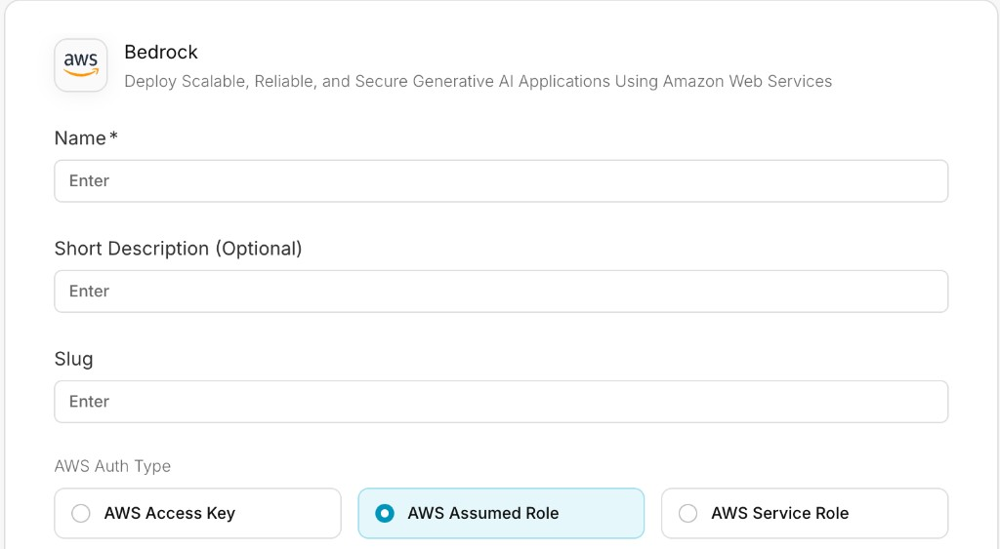
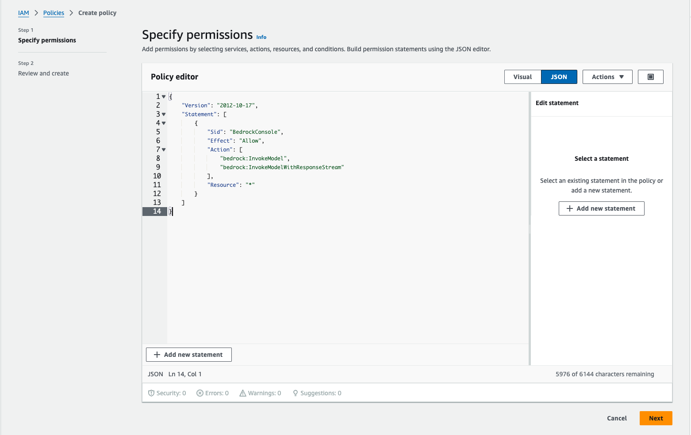
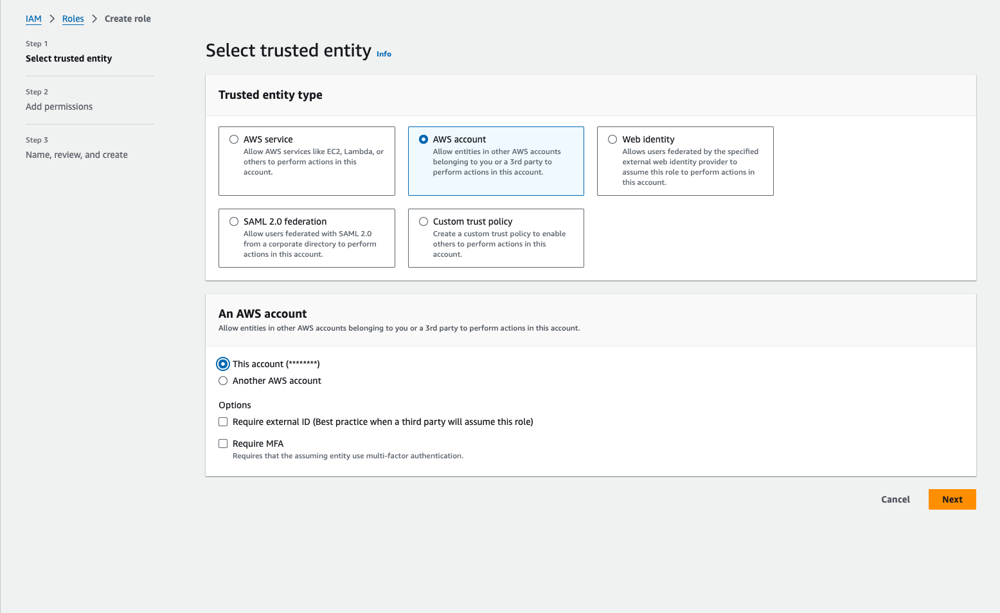
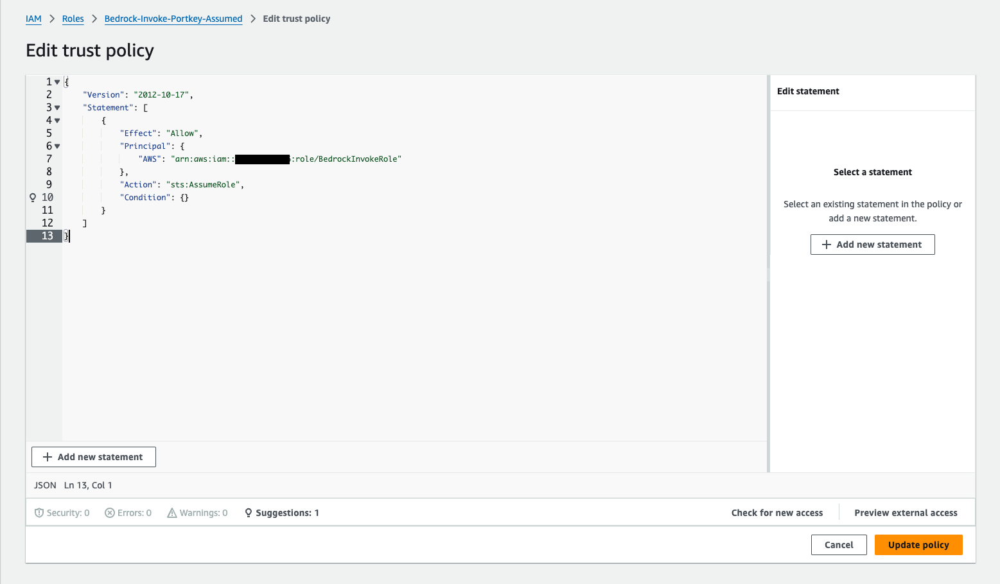
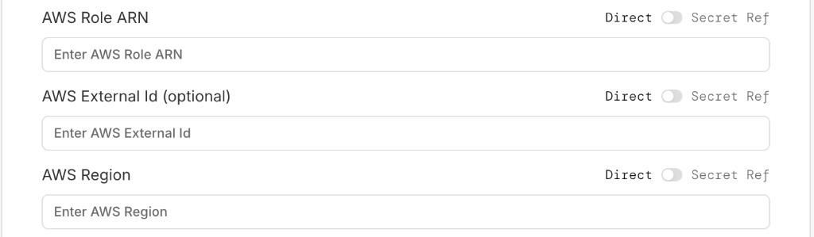

<Info>
Available on all plans.
</Info>

<Card title="Set Up Bedrock Authentication for Enterprise" href="https://github.com/Portkey-AI/helm/blob/main/charts/portkey-gateway/docs/Bedrock.md">
  On the Enterprise plan and need to connect to Bedrock using an AWS assumed role? Check out the documentation here.
</Card>


## Select AWS Assumed Role Authentication

Create a new integration on Portkey, select **Bedrock** as the provider and **AWS Assumed Role** as the authentication method.

<Frame>
  
</Frame>


## Create an AWS Role for Portkey to Assume
This role you create will be used by Portkey to execute InvokeModel commands on Bedrock models in your AWS account. The setup process will establish a minimal-permission ("least privilege") role and set it up to allow Portkey to assume this role.

### Create a permission policy in your AWS account using the following JSON

These actions cover standard inference — chat completions, the Messages API, embeddings, image generation, and token counting:

```json
{
  "Version": "2012-10-17",
  "Statement": [
    {
      "Sid": "BedrockConsole",
      "Effect": "Allow",
      "Action": [
        "bedrock:InvokeModel",
        "bedrock:InvokeModelWithResponseStream",
        "bedrock:CountTokens"
        ],
      "Resource": "*"
    }
  ]
}
```

<Note>
`bedrock:InvokeModel` and `bedrock:InvokeModelWithResponseStream` also authorize the Converse and ConverseStream APIs, which Portkey uses for most models.

`bedrock:CountTokens` backs the `/v1/messages/count_tokens` endpoint. Clients such as Claude Code call it on every turn, so omitting it shows up as `is not authorized to perform: bedrock:CountTokens`. It is a recent addition to Bedrock — roles created before it existed need it added explicitly.
</Note>

<Frame>
  
</Frame>

### Additional permissions by feature

Add these only if you use the corresponding feature — everything else works with the three actions above.

| Feature | Additional actions |
| :-- | :-- |
| [Inference profiles](/integrations/llms/bedrock/aws-bedrock#inference-profiles) (the model ID is an inference profile ARN) | `bedrock:GetInferenceProfile` |
| Model discovery (listing Bedrock models through Portkey) | `bedrock:ListFoundationModels` |
| [Bedrock Guardrails](/integrations/guardrails/bedrock-guardrails) | `bedrock:ApplyGuardrail` |
| [Reranking](/integrations/llms/bedrock/rerank) | `bedrock:Rerank` |
| [Batch inference](/integrations/llms/bedrock/batches) | `bedrock:CreateModelInvocationJob`, `bedrock:GetModelInvocationJob`, `bedrock:ListModelInvocationJobs`, `bedrock:StopModelInvocationJob`, plus S3 access to the input/output bucket and `iam:PassRole` for the Bedrock service role — see the [full batch policy](/integrations/llms/bedrock/batches#information-about-permissions-and-iam-roles) |
| [Fine-tuning](/integrations/llms/bedrock/fine-tuning) | `bedrock:CreateModelCustomizationJob`, `bedrock:GetModelCustomizationJob`, `bedrock:ListModelCustomizationJobs`, `bedrock:StopModelCustomizationJob`, plus S3 access to the training-data bucket and `iam:PassRole` |
| [Files](/integrations/llms/bedrock/files) | `s3:PutObject`, `s3:GetObject`, `s3:GetObjectAttributes`, `s3:AbortMultipartUpload`, `s3:ListBucket` on your bucket |


<Accordion title="Combined policy with every optional action">
```json
{
  "Version": "2012-10-17",
  "Statement": [
    {
      "Sid": "BedrockInference",
      "Effect": "Allow",
      "Action": [
        "bedrock:InvokeModel",
        "bedrock:InvokeModelWithResponseStream",
        "bedrock:CountTokens",
        "bedrock:ApplyGuardrail",
        "bedrock:Rerank",
        "bedrock:ListFoundationModels",
        "bedrock:GetFoundationModel",
        "bedrock:GetInferenceProfile"
      ],
      "Resource": "*"
    },
    {
      "Sid": "BedrockBatchAndFineTuning",
      "Effect": "Allow",
      "Action": [
        "bedrock:CreateModelInvocationJob",
        "bedrock:GetModelInvocationJob",
        "bedrock:ListModelInvocationJobs",
        "bedrock:StopModelInvocationJob",
        "bedrock:CreateModelCustomizationJob",
        "bedrock:GetModelCustomizationJob",
        "bedrock:ListModelCustomizationJobs",
        "bedrock:StopModelCustomizationJob",
        "bedrock:TagResource",
        "bedrock:UntagResource",
        "bedrock:ListTagsForResource"
      ],
      "Resource": "*"
    },
    {
      "Sid": "S3ForFilesAndJobIO",
      "Effect": "Allow",
      "Action": [
        "s3:ListBucket",
        "s3:PutObject",
        "s3:GetObject",
        "s3:GetObjectAttributes",
        "s3:AbortMultipartUpload"
      ],
      "Resource": [
        "arn:aws:s3:::<bucket>",
        "arn:aws:s3:::<bucket>/*"
      ]
    },
    {
      "Sid": "PassBedrockServiceRole",
      "Effect": "Allow",
      "Action": "iam:PassRole",
      "Resource": "arn:aws:iam::<account_id>:role/<bedrock_service_role>",
      "Condition": {
        "StringEquals": {
          "iam:PassedToService": "bedrock.amazonaws.com"
        }
      }
    }
  ]
}
```

Replace `<bucket>`, `<account_id>` and `<bedrock_service_role>` with your own values, and narrow each `Resource` to the model, inference profile and job ARNs you actually use.
</Accordion>

### Create a new IAM role
Choose *AWS account* as the trusted entity type. If you set an external ID be sure to copy it, we will need it later.

<Frame>
  
</Frame>

### Add the above policy to the role
Search for the policy you created above and add it to the role.

<Frame>
  
</Frame>

### Configure Trust Relationship for the role
Once the role is created, open the role and navigate to the *Trust relationships* tab and click *Edit trust policy*.
This is where you will add the Portkey AWS account as a trusted entity.

```sh Portkey Account ARN
arn:aws:iam::299329113195:role/portkey-app
```

<Note>
The above ARN only works for our [hosted app](https://app.portkey.ai/).<br />

To enable **Assumed Role for AWS in your Portkey Enterprise deployment**, you can refer to [this guide](https://github.com/Portkey-AI/helm/blob/main/charts/portkey-gateway/docs/Bedrock.md). If you face any issue, please reach out to [Portkey support](https://support.portkey.ai/forms/customer-portal-ticket-form).
</Note>

Paste the following JSON into the trust policy editor and click *Update Trust Policy*.

```json
{
  "Version": "2012-10-17",
  "Statement": [
    {
      "Effect": "Allow",
      "Principal": {
        "AWS": "arn:aws:iam::299329113195:role/portkey-app"
      },
      "Action": "sts:AssumeRole",
      "Condition": {}
}
]
}
```

If you set an external ID, add it to the condition as shown below.

```json
  {
    "Version": "2012-10-17",
    "Statement": [
      {
        "Effect": "Allow",
        "Principal": {
          "AWS": "<Portkey Account ARN>"
        },
        "Action": "sts:AssumeRole",
        "Condition": {
          "StringEquals": {
            "sts:ExternalId": "<your external ID>"
          }
        }
      }
    ]
}
```


## Configure the integration with the role ARN
Once the role is created, copy the role ARN and paste it into the Bedrock integrations modal in Portkey along with the external ID if you set one and the AWS region you are using.

<Frame>
  
</Frame>

 You're all set! You can now use the providers inherited from your integration to invoke Bedrock models.


import PrismaAirsCta from "/snippets/prisma-airs-cta.mdx";

<PrismaAirsCta />
