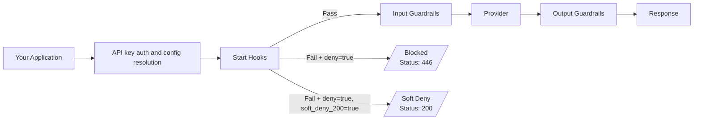

Start hooks are a guardrail lifecycle stage that runs **before** [input guardrails](/product/guardrails). Where input and output guardrails inspect the content of a prompt or a response, start hooks look at the **envelope** of a request: its headers, metadata, endpoint, and caller identity.

Use them to enforce rules that don't depend on the prompt:

- Reject requests that are missing required metadata or headers
- Validate a JWT and pass its claims downstream as headers and metadata
- Restrict which endpoints a key, workspace, or organization can call
- Strip or rewrite headers before the request is routed

Because start hooks work on the envelope, they apply to **every request** that reaches the LLM Gateway, not only chat completions.

## Where Start Hooks Run



1. The gateway authenticates the API key and resolves the request's config, along with the start hooks inherited from the organization and workspace.
2. Start hooks run. If any hook with `deny: true` fails, the request stops here. No input guardrail runs and no provider is called.
3. If the start hooks pass, the request continues to input guardrails, the provider, and output guardrails as usual. Any header or metadata changes made by the start hooks are applied to the request first.

<Note>
Start hooks run after authentication, so the gateway already knows which organization and workspace the request belongs to. They are not a replacement for API key authentication.
</Note>

## What a Start Hook Can See

Start hooks run before the request body is processed, so a check sees:

| Available to start hooks | Not available |
| :--- | :--- |
| Request headers (internal gateway headers are removed) | The request body: prompt, messages, parameters |
| Request metadata | The provider response |
| Request path and endpoint type | |
| Provider, if set | |

Use [input guardrails](/product/guardrails) for anything that needs to read the prompt.

## Supported Checks

Not every guardrail check can run as a start hook, and the Guardrails page does not filter the check list for you. When you create a guardrail you intend to use as a start hook, pick only the checks in this table.

| Check | What it does at the start stage | Can also run as an input guardrail |
| :--- | :--- | :--- |
| **Header Check** (`headerCheck`) | Allows or blocks a request based on whether its headers match key-value pairs | No, start hooks only |
| **Header Transform** (`headerTransform`) | Removes, sets, or conditionally rewrites request headers | No, start hooks only |
| **Required Metadata Keys** (`requiredMetadataKeys`) | Requires, or prohibits, specific metadata keys | Yes |
| **Allowed Request Types** (`allowedRequestTypes`) | Allows or blocks endpoints with an allowlist or blocklist | Yes, with differences. See [Allowed Request Types](#allowed-request-types) |
| **[JWT](/integrations/guardrails/jwt)** (`jwt`) | Validates a bearer token. As a start hook it can also extract claims into headers and metadata | Yes, but claim extraction applies only to start hooks |
| **Webhook** (`webhook`) | Sends the request context to your service, which returns the verdict. Request headers are not sent to the webhook | Yes |

### Header Check

Compares request headers with the key-value pairs you list. Header names are matched case-insensitively. Use `*` as a value to match any value, so the check tests only whether the header is present.

| Parameter | Description |
| :--- | :--- |
| `headerPairs` | Object of header names and expected values |
| `operator` | `all`: every pair must match. `any`: at least one pair must match. `none`: no pair may match |

```json
{
  "headerPairs": { "x-portkey-debug": "false" },
  "operator": "none"
}
```

This example fails any request that sends `x-portkey-debug: false`. Use it to stop clients from turning off request logging.

The check result lists the names of the headers that matched and didn't match, never their values, so secrets in headers don't end up in logs.

### Header Transform

Rewrites headers before the request is routed. It never denies a request.

| Parameter | Description |
| :--- | :--- |
| `remove` | Header names to drop |
| `removeIf` | Drops headers when a condition on another header is met. Use `equals` or `exists` as the condition, with `drop` (header names) or `dropValues` (comma-separated values to strip from the condition header) |
| `set` | Header names and values to add or overwrite |
| `setIf` | Sets headers when a condition (`equals` or `exists`) on another header is met |

```json
{
  "remove": ["x-debug"],
  "set": { "x-env": "production" },
  "removeIf": {
    "x-env": { "equals": "staging", "drop": ["x-experimental"] }
  }
}
```

<Warning>
Header Transform cannot touch authentication headers (`cookie`, `set-cookie`, `x-api-key`, `x-portkey-api-key`, `api-key`, `apikey`, `x-auth-token`, `x-access-token`, `x-user-claims`, `x-user-jwt`) or any `x-portkey-*` header. If a transform references one of these, the whole check is rejected and **none** of its changes are applied.
</Warning>

<Warning>
Header Transform can't change headers that the gateway itself interprets when it builds the upstream call, such as `anthropic-beta` and `anthropic-version`. For these, the gateway reads the value from the request as the client sent it, so a transform that removes or overwrites them is accepted and reported as applied, but has no effect on what the provider receives. To control these values, have the client send them, or set `anthropic_beta` in the request body.
</Warning>

<Warning>
If a guardrail uses Header Transform, turn on **Execute guardrails sequentially** (`"sequential": true`) for that guardrail. Checks then run one after another, and each check sees the headers as changed by the checks before it. Without it, checks run in parallel and a check placed after Header Transform, such as a Header Check that verifies the new header, can still see the original headers.
</Warning>

<Note>
Header Transform changes the headers the gateway sends upstream. It can't make the provider act on them. A provider is free to ignore any header it doesn't recognize, and the headers a transform sets or removes usually don't appear in the response JSON. To confirm a transform ran, look at the `headerTransform` check in `hook_results.start_hooks` or in the request log, which list the names of the headers removed and set.
</Note>

### Required Metadata Keys

Checks the request's metadata keys.

| Parameter | Description |
| :--- | :--- |
| `metadataKeys` | Array of metadata key names |
| `operator` | `all`: every key must be present. `any`: at least one must be present. `none`: none of the keys may be present |

### Allowed Request Types

Controls which endpoints can be called. Provide `allowedTypes`, `blockedTypes`, or both. If a type appears in both lists the check returns an error. With neither, all request types are allowed.

```json
{
  "allowedTypes": ["chatComplete", "messages", "embed"]
}
```

If you leave both parameters empty, the check reads `supported_endpoints` and `blocked_endpoints` (comma-separated) from the request metadata instead.

#### Request types a start hook recognizes

A start hook matches the endpoint the client called, based on the request path:

| Request path | Request type |
| :--- | :--- |
| `/v1/chat/completions` | `chatComplete` |
| `/v1/completions` | `complete` |
| `/v1/embeddings` | `embed` |
| `/v1/rerank` | `rerank` |
| `/v1/messages` | `messages` |
| `/v1/messages/count_tokens` | `messagesCountTokens` |
| `/v1/responses` | `modelResponse`. Also accepted as `createModelResponse` |
| `/v1/images/generations` | `imageGenerate` |
| `/v1/images/edits` | `imageEdit` |
| `/v1/audio/speech` | `createSpeech` |
| `/v1/audio/transcriptions` | `createTranscription` |
| `/v1/audio/translations` | `createTranslation` |
| `/v1/files` | `files`. Also accepted as `uploadFile`, `listFiles`, `retrieveFile`, `deleteFile`, `retrieveFileContent` |
| `/v1/batches` | `batches`. Also accepted as `createBatch` |
| `/v1/fine_tuning/jobs` | `finetune`. Also accepted as `createFinetune` |
| `/v1/realtime` | `realtime` |

A request to any other path is matched by its path, for example `/v1/models`. In a start hook, `files`, `batches`, `finetune`, and `modelResponse` each cover every operation on that endpoint family, so `blockedTypes: ["files"]` blocks uploads, listing, retrieval, and deletion alike.

#### Using it as an input guardrail

Allowed Request Types also runs as an input guardrail, with these differences:

- It sees the gateway's internal request type for the call, not the original path. When the gateway adapts a request for a provider, the type can change. For example, a `/v1/messages` request sent to a provider without a native Messages API is handled as `chatComplete`.
- The family names `files`, `batches`, `finetune`, and `modelResponse` are not recognized. List the specific operation, such as `uploadFile` or `createBatch`.

<Note>
Other input guardrails run only on `chatComplete`, `complete`, `embed`, `messages`, `createBatch`, `createFinetune`, `createModelResponse`, and `decisions` requests. Allowed Request Types is exempt from this restriction so that it can act on any endpoint. Start hooks have no such restriction.
</Note>

### JWT

Start hooks are the only place JWT validation can do more than pass or fail. When `extractClaims` is set and the token is valid, the gateway writes those claims into the request:

- As headers, named `claimPrefix` plus the claim name (default `x-jwt-`, for example `x-jwt-sub`)
- As metadata, named `metadataPrefix` plus the claim name (default: no prefix, for example `sub`)

Claim values overwrite any client-supplied header or metadata key of the same name. If validation fails, or the token lacks a configured claim, the client-supplied value is removed, so a caller can't spoof a claim. See the [JWT guardrail](/integrations/guardrails/jwt) for the full parameter list.

## Create a Start Hook

There is no separate "start hook" guardrail type on the **Guardrails** page. A start hook is a regular guardrail that you attach to the start stage. (Creating a guardrail from **Admin Settings** > **Organisation Guardrails** > **Start Hooks** does limit the check list to compatible checks.)

1. Go to **Guardrails** and click **Create**.
2. Enter a name and choose **LLM APIs** as the target. The target can't be changed after the guardrail is created.
3. Add one or more checks from the [supported checks](#supported-checks) list and configure their parameters.
4. On the **Actions** tab, choose the guardrail actions, described under [Deny, Soft Deny, and Log Only](#deny-soft-deny-and-log-only). If the guardrail uses Header Transform, turn on **Execute guardrails sequentially**.
5. Save the guardrail.

<Warning>
The workspace settings don't filter guardrails by the stage they are meant for. When you pick a guardrail under **Start Hook Guardrail** in a workspace, the list shows all guardrails in the workspace, including ones with checks that can't run at the start stage, such as a regex match or a PII check. Choose only guardrails made of the [supported checks](#supported-checks). A check that can't run at the start stage may return errors or not enforce what you intended, because start hooks don't see the request body. The same applies to guardrails you reference from a config, described under [Attach a Start Hook in a Config](#attach-a-start-hook-in-a-config).
</Warning>

### Example: Block Clients from Turning Off Request Logging

This example blocks every request in a workspace that sends `x-portkey-debug: false`, so clients can't opt out of request logging.

1. Open **Guardrails** and click **Create**.

   <Frame>
     
   </Frame>

2. In the **Add Guardrail** dialog, enter the name `block-debug-opt-out`, keep **LLM APIs** selected as the target, and click **Continue**.

   <Frame>
     
   </Frame>

3. Under **Available Checks**, search for `header` and click **Add** on **Header Check**.

   <Frame>
     
   </Frame>

4. Set **Operator** to `none` and **Header Key-Value Pairs** to `{"x-portkey-debug": "false"}`, then click **Save**. With `none`, the check fails when the request sends any of the listed pairs.

   <Frame>
     
   </Frame>

5. Switch to the **Actions** tab and select **Deny on Failure** under **Additional Settings**, then save the guardrail. The **On Success** and **On Failure** feedback settings on the left are optional and don't affect whether the request is blocked.

   <Frame>
     
   </Frame>

6. Open your workspace's settings and go to **Workspace Guardrails**. The page has three sections: **Input Guardrail**, **Output Guardrail**, and **Start Hook Guardrail**.

   <Frame>
     
   </Frame>

7. Under **Start Hook Guardrail**, open **Select Start Hook Guardrail** and choose `block-debug-opt-out`.

   <Frame>
     
   </Frame>

   <Warning>
   This list shows every guardrail in the workspace, such as `xsxs` and `Word_Count` above, not only the ones that can run as start hooks. Some of them may not be start hook compliant. Select only guardrails made of the [supported checks](#supported-checks).
   </Warning>

8. Click **Update** to save.

   <Frame>
     
   </Frame>

9. Send a request with the `x-portkey-debug: false` header. It returns `446` and never reaches the provider. The response lists the check that failed and the header that matched. A request that doesn't send the header, or sends `x-portkey-debug: true`, goes through.

   <Frame>
     
   </Frame>

To enforce the same guardrail across the whole organization, add it under **Admin Settings** > **Organisation Guardrails** > **Start Hooks** instead. See [Enforcing Policies with Start Hooks](/product/administration/enforce-policies-with-start-hooks).

A start hook guardrail takes effect once it is attached to requests. You can attach it in three places:

| Where | Applies to | Learn more |
| :--- | :--- | :--- |
| Config `start_hooks` | Requests that use that config | [Attach a start hook in a config](#attach-a-start-hook-in-a-config) |
| Workspace settings | Every request in the workspace | [Enforcing policies with start hooks](/product/administration/enforce-policies-with-start-hooks) |
| Organization settings | Every request in every workspace | [Enforcing policies with start hooks](/product/administration/enforce-policies-with-start-hooks) |

### Attach a Start Hook in a Config

<Warning>
Use only [checks that support start hooks](#supported-checks) in `start_hooks`, whether you reference a saved guardrail by ID or define the hook inline. Neither the gateway nor the config editor checks whether a check supports the start stage, so a config with an unsupported check is saved and accepted without any error. At request time the check still runs, but it has no request body or response to work with. For example, a Regex Match check reports an error such as "Missing text to match", and unless the check has `failOnError` set, that error does not block the request. The policy you meant to enforce is then silently not applied.
</Warning>

Add the guardrail's ID to `start_hooks` in a [config](/product/ai-gateway/configs):

```json
{
  "provider": "@openai-xxx",
  "start_hooks": ["guardrails-id-xxx"]
}
```

To set the actions for a hook for this config only, use the object form:

```json
{
  "provider": "@openai-xxx",
  "start_hooks": [
    {
      "id": "guardrails-id-xxx",
      "deny": true,
      "soft_deny_200": false
    }
  ]
}
```

The object form accepts the same action keys as `before_request_hooks`: `deny`, `soft_deny_200`, `async`, `on_fail`, and `on_success`.

### Define a Start Hook Inline

You can also send the full hook definition in the `x-portkey-config` header, without creating a guardrail first. This is useful for testing:

```bash
curl https://api.portkey.ai/v1/chat/completions \
  -H "Content-Type: application/json" \
  -H "x-portkey-api-key: $PORTKEY_API_KEY" \
  -H 'x-portkey-config: {
    "start_hooks": [{
      "id": "require-team-header",
      "type": "guardrail",
      "deny": true,
      "checks": [{
        "id": "default.headerCheck",
        "parameters": {
          "headerPairs": { "x-team": "*" },
          "operator": "all"
        }
      }]
    }]
  }' \
  -d '{
    "model": "@openai-xxx/gpt-4o-mini",
    "messages": [{ "role": "user", "content": "Hello" }]
  }'
```

A request without an `x-team` header is blocked before it reaches the provider.

## Deny, Soft Deny, and Log Only

What happens when a start hook fails depends on its actions.

| Verdict | `deny` | `soft_deny_200` | Result |
| :--- | :--- | :--- | :--- |
| Pass | any | any | The request continues |
| Fail | `false` | any | The request continues. The failure is logged and appears in `hook_results` |
| Fail | `true` | `false` | The request is blocked with status `446` |
| Fail | `true` | `true` | The request is blocked, but the response has status `200` and the normal shape for the endpoint |

<Note>
Unlike a failed input guardrail with `deny: false`, a failed start hook does not change the response status to `246`. The request continues with its usual status and you can read the failure from `hook_results.start_hooks`.
</Note>

### Hard Deny (`446`)

```json
{
  "status": "failure",
  "message": "Request denied by start hook guardrail",
  "details": {
    "hookId": "require-team-header",
    "checks": [
      {
        "id": "default.headerCheck",
        "verdict": false,
        "data": {
          "explanation": "Check failed for 'all' header key-value pairs. Some header key-value pairs did not match.",
          "matched_keys": [],
          "unmatched_keys": ["x-team"],
          "operator": "all"
        }
      }
    ]
  }
}
```

The `message` is the guardrail's custom error message if you set one (up to 512 characters). Otherwise it is `Request denied by start hook guardrail`.

<Note>
This error body is different from the one returned for a failed input guardrail, which uses an `error` object and `hook_results`. If your client already parses `446` responses from input guardrails, handle the start hook shape too.
</Note>

### Soft Deny (`200`)

With `soft_deny_200: true`, the client gets a `200` response shaped like a normal response for the endpoint. For chat completions, the assistant message contains the guardrail's custom error message, or the default guardrail failure message if none is set, and the guardrail results are included in `hook_results`. For streaming requests the gateway sends a well-formed event stream, so client SDKs don't fail while parsing it.

Use soft deny when a client can't handle a non-`2xx` status.

### Log Only

With `deny: false`, the hook never blocks. Use it to watch for violations before you start enforcing them.

### Async Start Hooks

With `async: true`, the hook runs after the response has been sent and cannot affect the request. Use it for logging and auditing. Header and metadata changes from async hooks are not applied.

## Reading Results

Start hook results are reported separately from the other hook types:

- In responses, under `hook_results.start_hooks`, next to `before_request_hooks` and `after_request_hooks`
- In [logs](/product/observability/logs), on the **Feedback & Guardrails** tab of the log drawer, recorded with the `startHook` event type

```json
{
  "hook_results": {
    "start_hooks": [
      {
        "id": "require-team-header",
        "verdict": true,
        "deny": false,
        "checks": [
          {
            "id": "default.headerCheck",
            "verdict": true,
            "data": {
              "explanation": "Check passed for 'all' header key-value pairs. All header key-value pairs matched.",
              "matched_keys": ["x-team"],
              "unmatched_keys": [],
              "operator": "all"
            }
          }
        ]
      }
    ],
    "before_request_hooks": [],
    "after_request_hooks": []
  }
}
```

<Note>
On streaming requests, set the `x-portkey-strict-open-ai-compliance` header to `false` to receive `hook_results` in the stream. See [Guardrails](/product/guardrails) for details.
</Note>

## How Hooks Combine

- **Multiple hooks:** Every start hook runs, and the request is blocked if any hook with `deny: true` fails.
- **Multiple checks in one hook:** The checks run in parallel by default, and the hook passes only if all of them pass. To make later checks see the changes of earlier ones, such as a Header Check that verifies a Header Transform, define the hook with `"sequential": true`.
- **Header and metadata changes:** Changes from Header Transform and JWT claim extraction are applied only if the request is allowed to continue.

## Handling Check Errors

If a check can't complete, for example a webhook times out or a JWT can't be verified, the error is recorded in the check result. By default a check that errors does **not** block the request. For checks that enforce a policy, set `failOnError` to `true` in the check's parameters so an error counts as a failure:

```json
{
  "id": "default.webhook",
  "parameters": {
    "webhookURL": "https://guardrails.example.com/start-check",
    "timeout": 3000,
    "failOnError": true
  }
}
```

A hook that is defined in a config but has no usable checks, for example because every check ID is unknown, is treated as failed. A hook with `deny: true` blocks the request instead of silently letting it through.

## Related

<CardGroup cols={2}>
  <Card title="Enforcing Policies with Start Hooks" href="/product/administration/enforce-policies-with-start-hooks">
    Apply start hooks to every request in a workspace or organization
  </Card>
  <Card title="Guardrails" href="/product/guardrails">
    Input and output guardrails, actions, and response structure
  </Card>
</CardGroup>
