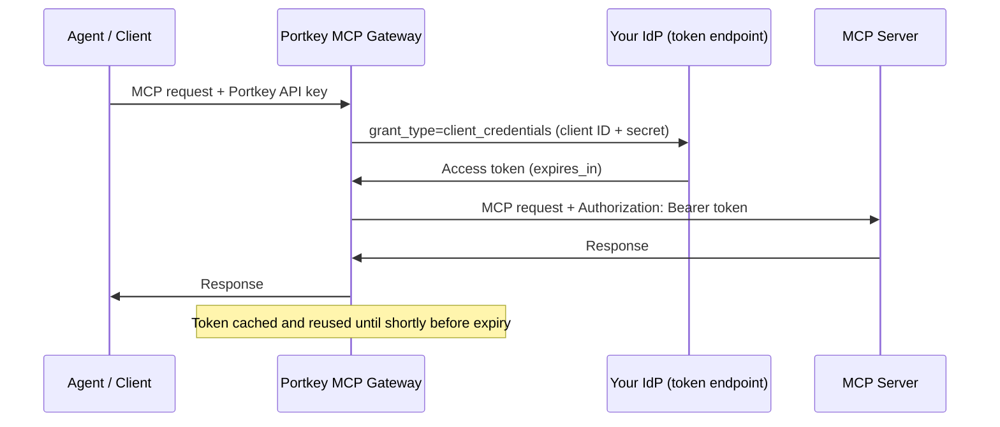
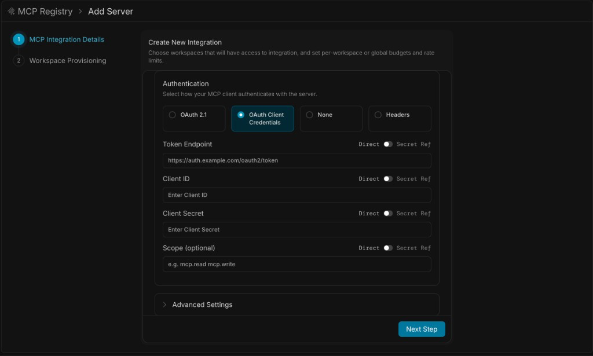

Some MCP servers don't identify individual users. They trust a **service identity** instead: a client ID and secret issued by an identity provider (IdP), exchanged for a short-lived access token. This is the OAuth 2.0 **client credentials** grant, also called machine-to-machine (M2M) auth.

Configure it once on the MCP integration. Portkey requests tokens, caches them, refreshes them before they expire, and sends them to the MCP server. Agents never see the credentials.



---

## When to Use

Use client credentials when:
- The MCP server sits behind your own IdP (Keycloak, Microsoft Entra ID, Amazon Cognito, and similar) and accepts service tokens
- Access is to shared resources (knowledge bases, internal APIs, analytics) rather than personal data
- No user should be prompted to sign in to the MCP server

Use [OAuth 2.1](/product/mcp-gateway/authentication/oauth) instead when each user needs their own access to the server, such as their email or repositories.

| | Client Credentials | OAuth 2.1 (per user) |
|---|---|---|
| **Who the MCP server sees** | One service identity | Each user |
| **User sign-in to the MCP server** | None | Required once per user |
| **Token** | One per server, per workspace | One per user |
| **Best for** | Shared resources, service-to-service | Personal data, per-user attribution |

<Note>
Agents still authenticate to Portkey separately, with an API key or another [gateway auth method](/product/mcp-gateway/authentication). Client credentials only covers the second hop, Portkey to the MCP server.
</Note>

---

## Prerequisites

Set these up at your IdP first:

1. **A confidential client** that can use the client credentials grant, with a client ID and client secret
2. **A scope** the client may request (most IdPs require one). Portkey sends only the scope you configure
3. **The token endpoint URL.** It must use **HTTPS** and be reachable from the gateway
4. **An MCP server** that accepts access tokens from this IdP

Verify the client works before configuring Portkey:

```sh
curl -s -u "$CLIENT_ID:$CLIENT_SECRET" \
    -d grant_type=client_credentials \
    -d scope="$SCOPE" \
    "$TOKEN_ENDPOINT"
```

The response contains an `access_token` and `expires_in`. If this call fails, Portkey's request fails the same way.

### Where to find the token endpoint

| IdP | Token endpoint | Scope format |
|-----|----------------|--------------|
| Okta | `https://<okta-domain>/oauth2/<authorization-server-id>/v1/token` (`default` for the default server) | A custom scope you create on the authorization server, such as `mcp.read` |
| Keycloak | `https://<host>/realms/<realm>/protocol/openid-connect/token` | A client scope assigned to the client, such as `mcp.read` |
| Microsoft Entra ID | `https://login.microsoftonline.com/<tenant>/oauth2/v2.0/token` | `api://<app-id>/.default` |
| Amazon Cognito | `https://<domain>.auth.<region>.amazoncognito.com/oauth2/token` | `<resource-server>/<scope>` |

For Okta, create an **API Services** app, add a custom scope to the authorization server, and add an access policy rule that allows the **Client Credentials** grant for that app.

<Note>
Not every IdP and plan offers the client credentials grant. Okta, for example, offers it only to orgs with an NHI Authentication Token subscription purchased or renewed on or after August 14, 2026. If the token request fails with a message about a missing entitlement, check your IdP plan before debugging Portkey.
</Note>

---

## Configure in the UI

<Frame>
  
</Frame>

<Steps>
<Step title="Add the server">
  Go to **MCP Registry** and click **Add Server**. Enter the server's name, URL, and transport.
</Step>
<Step title="Select the auth type">
  Under **Authentication**, choose **OAuth Client Credentials**.
</Step>
<Step title="Enter the credentials">
  | Field | Value |
  |-------|-------|
  | **Token Endpoint** | The IdP's token URL. Must start with `https://` |
  | **Client ID** | The client's ID |
  | **Client Secret** | The client's secret |
  | **Scope** | Optional. Space-separated scopes to request, such as `mcp.read mcp.write` |
</Step>
<Step title="Provision and create">
  Click **Next Step**, choose the workspaces that get access, and create the server.
</Step>
</Steps>

Token Endpoint and Client ID are required. Client Secret is needed for most IdPs. Scope is optional: when empty, Portkey sends no scope and the IdP applies the client's defaults.

### Store credentials in a secret reference

Each field has a **Direct / Secret Ref** toggle. Switch a field to **Secret Ref** to read its value from your vault instead of storing it in Portkey. Store the client secret there at minimum.

See [Secret References](/product/enterprise-offering/secret-references) to connect a vault.

<Warning>
Fields set to a secret reference aren't stored as direct values. If a field already had a direct value, switching to a secret reference and saving replaces it.
</Warning>

---

## Configure with the API

Create the integration with `auth_type` set to `oauth_client_credentials` and the credentials under `configurations.oauth_client_credentials`:

<CodeGroup>
```sh cURL
curl -X POST https://api.portkey.ai/v1/mcp-integrations \
    -H "x-portkey-api-key: $PORTKEY_API_KEY" \
    -H "Content-Type: application/json" \
    -d '{
        "name": "Internal Knowledge Base",
        "slug": "internal-kb",
        "url": "https://mcp.example.com/mcp",
        "transport": "http",
        "auth_type": "oauth_client_credentials",
        "configurations": {
            "oauth_client_credentials": {
                "token_endpoint": "https://auth.example.com/oauth2/token",
                "client_id": "portkey-mcp-client",
                "client_secret": "<CLIENT_SECRET>",
                "scope": "mcp.read"
            }
        }
    }'
```

```python Python
import requests

resp = requests.post(
    "https://api.portkey.ai/v1/mcp-integrations",
    headers={"x-portkey-api-key": PORTKEY_API_KEY},
    json={
        "name": "Internal Knowledge Base",
        "slug": "internal-kb",
        "url": "https://mcp.example.com/mcp",
        "transport": "http",
        "auth_type": "oauth_client_credentials",
        "configurations": {
            "oauth_client_credentials": {
                "token_endpoint": "https://auth.example.com/oauth2/token",
                "client_id": "portkey-mcp-client",
                "client_secret": CLIENT_SECRET,
                "scope": "mcp.read"
            }
        }
    }
)
```

```js JavaScript
const resp = await fetch("https://api.portkey.ai/v1/mcp-integrations", {
    method: "POST",
    headers: {
        "x-portkey-api-key": PORTKEY_API_KEY,
        "Content-Type": "application/json"
    },
    body: JSON.stringify({
        name: "Internal Knowledge Base",
        slug: "internal-kb",
        url: "https://mcp.example.com/mcp",
        transport: "http",
        auth_type: "oauth_client_credentials",
        configurations: {
            oauth_client_credentials: {
                token_endpoint: "https://auth.example.com/oauth2/token",
                client_id: "portkey-mcp-client",
                client_secret: CLIENT_SECRET,
                scope: "mcp.read"
            }
        }
    })
})
```
</CodeGroup>

### Configuration fields

All fields live under `configurations.oauth_client_credentials`.

| Field | Required | Description |
|-------|----------|-------------|
| `token_endpoint` | Yes | IdP token URL. Must be HTTPS |
| `client_id` | Yes | OAuth client ID |
| `client_secret` | Usually | OAuth client secret. Omit only for IdPs that don't require one |
| `scope` | No | Space-separated scopes to request. Nothing is sent when omitted |
| `token_endpoint_auth_methods_supported` | No | API only. How the secret is sent, such as `["client_secret_post"]`. Default is HTTP Basic |
| `issuer` | No | API only. Rarely needed. Defaults to the token endpoint's origin |

### Reference the secret from a vault

Map the secret with `secret_mappings` instead of sending `client_secret`:

```json
{
    "auth_type": "oauth_client_credentials",
    "configurations": {
        "oauth_client_credentials": {
            "token_endpoint": "https://auth.example.com/oauth2/token",
            "client_id": "portkey-mcp-client",
            "scope": "mcp.read"
        }
    },
    "secret_mappings": [{
        "target_field": "configurations.oauth_client_credentials.client_secret",
        "secret_reference_id": "my-mcp-client-secret"
    }]
}
```

---

## How It Works

**Token requests.** Portkey sends a `POST` to the token endpoint with `grant_type=client_credentials`, plus `scope` when configured. The client ID and secret are sent with HTTP Basic authentication.

**Caching.** Portkey keeps one token per server per workspace and shares it across all users and gateway instances. It doesn't request a new token for every call.

**Refresh.** A token is replaced shortly before it expires, up to 60 seconds early (less for very short-lived tokens). If the IdP doesn't return `expires_in`, Portkey assumes one hour. If the MCP server answers `401`, Portkey requests a new token and retries once.

**Config changes.** Changing the credentials, scope, or endpoint takes effect without a restart, and Portkey requests a new token with the new values. See [Configuration changes aren't taking effect](/help-center/mcp-gateway-troubleshooting#configuration-changes-arent-taking-effect) if a change seems stuck.

### What Portkey sends where

| Request | Goes to | Contains |
|---------|---------|----------|
| Token request | IdP token endpoint | Client credentials and the standard OAuth headers only |
| MCP request | MCP server | `Authorization: Bearer <token>`, plus your [custom headers](/product/mcp-gateway/authentication/custom-auth), [forwarded headers](/product/mcp-gateway/authentication/forwarding-headers), and [identity headers](/product/mcp-gateway/authentication/identity-forwarding) |

Static, forwarded, and identity headers never reach the IdP.

---

## Security

- **HTTPS only.** Token endpoints that don't use HTTPS are rejected, since the secret is sent with every token request.
- **No private addresses.** Token endpoints that resolve to private or reserved network addresses are blocked. On self-hosted and hybrid gateways, allow an internal IdP by adding its host to `TRUSTED_CUSTOM_HOSTS`. See [Custom Hosts](/product/ai-gateway/custom-hosts#trusted-custom-hosts-allowlist).
- **No silent fallback.** If the client ID or a valid token endpoint is missing, requests to the server fail. Portkey doesn't fall back to static headers.
- **Credential isolation.** Agents see only their Portkey credentials, never the client secret or access token.
- **Shared identity.** Every user of the server acts as the same service identity at the MCP server. Don't use it for per-user permissions or attribution. Use [OAuth 2.1](/product/mcp-gateway/authentication/oauth) for those.

<Warning>
Client secrets are stored by Portkey unless you use a secret reference. Use a secret reference and rotate the secret at your IdP on a schedule.
</Warning>

---

## Rotate the Secret

1. Create a new secret for the client at your IdP
2. Update **Client Secret** in the integration (or the vault entry it references)
3. Revoke the old secret

The next request uses the new secret and gets a new token. No agent changes are needed.

---

## Limitations

Portkey sends only `grant_type` and `scope` on the token request.

- **No extra token parameters.** IdPs that require one, such as an `audience` or `resource` parameter, aren't supported yet. Auth0, for example, typically expects an audience
- **Client secret authentication only.** `private_key_jwt` and mutual TLS aren't supported
- **Scopes come from configuration.** A scope named in the MCP server's `WWW-Authenticate` challenge doesn't change the request
- **One identity per server.** The same credentials apply to every user and workspace that uses the integration

---

## Troubleshooting

The MCP client usually shows only a generic connection error. Look for the cause in your IdP's logs, where a failed token request appears.

| Symptom | Likely cause | Fix |
|---------|--------------|-----|
| IdP logs a failed client authentication, or returns `invalid_client` | Wrong client ID or secret, or the client isn't confidential | Re-check the values with the `curl` call from [Prerequisites](#prerequisites) |
| `invalid_scope` | The scope isn't allowed for this client | Assign the scope to the client at the IdP, or fix the **Scope** field |
| `unsupported_grant_type`, or `invalid_grant` with an entitlement message (Okta: "The NHI Authentication Tokens SKU is not enabled") | The IdP or plan doesn't allow client credentials | Enable the grant for the client, or check your IdP plan |
| IdP requires `audience` or another parameter | See [Limitations](#limitations) | Use an IdP configuration that doesn't require it |
| Saving is refused: "Token Endpoint must use https" | The endpoint starts with `http://` | Use the HTTPS URL |
| Requests fail right after saving | Token endpoint is missing, not HTTPS, or points to a private address | Fix the endpoint. For an internal IdP on a self-hosted gateway, add it to `TRUSTED_CUSTOM_HOSTS` |
| Token request succeeds, MCP server answers `401` | The server rejects the token: wrong issuer or audience, or a missing scope | Align the MCP server's validation with the IdP's token |
| Works for a while, then fails | Secret was rotated or revoked at the IdP | Update the secret in the integration |

---

## Related

| Topic | Description |
|-------|-------------|
| [Authentication Overview](/product/mcp-gateway/authentication) | How gateway and server authentication fit together |
| [OAuth 2.1](/product/mcp-gateway/authentication/oauth) | Per-user authentication to MCP servers |
| [Custom Auth](/product/mcp-gateway/authentication/custom-auth) | Static headers and API keys |
| [Secret References](/product/enterprise-offering/secret-references) | Keep credentials in your own vault |
| [MCP Gateway Troubleshooting](/help-center/mcp-gateway-troubleshooting) | Fix common connection problems |


import PrismaAirsCta from "/snippets/prisma-airs-cta.mdx";

<PrismaAirsCta />
