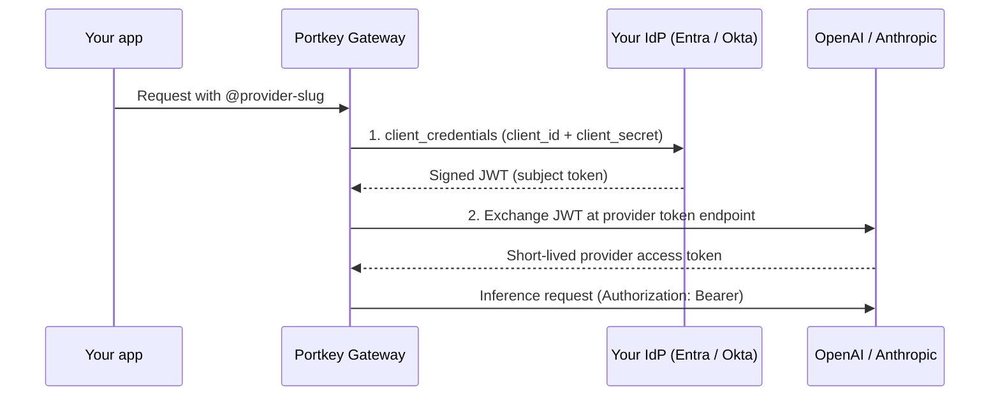

Workload Identity Federation (WIF) replaces a stored provider API key with a short-lived token from your own identity provider (IdP). Portkey never holds an OpenAI or Anthropic key. Revoke access by disabling the IdP app, the provider-side mapping, or the federation rule.

Supported providers: **OpenAI** and **Anthropic**.
Supported identity source: **Configured IdP** (`configuredIdp`). Portkey uses the OAuth 2.0 client credentials flow against your IdP.

## How it works



1. **IdP token:** Portkey sends a `client_credentials` request to your IdP's token endpoint. The IdP returns a signed JWT for the Portkey client app.
2. **Provider exchange:** Portkey exchanges that JWT with the provider:

| Provider | Token endpoint | Grant |
| --- | --- | --- |
| OpenAI | `https://auth.openai.com/oauth/token` | RFC 8693 token exchange (`subject_token`) |
| Anthropic | `https://api.anthropic.com/v1/oauth/token` | RFC 7523 JWT bearer (`assertion`) |

The provider verifies the JWT signature with your IdP's public keys. It checks `iss`, `aud`, and `sub` against your configured rules, then issues a short-lived access token for a service account.

Portkey caches both tokens and refreshes them before they expire. Provider tokens are cached for no more than 15 minutes. Rotating the client secret invalidates the cache.

## Setup overview

| Where | What to configure | Values to copy |
| --- | --- | --- |
| **Identity provider** | A confidential client app that can use client credentials | Token endpoint, client ID, client secret, scope, and the issued token's `iss`, `aud`, and `sub` |
| **OpenAI / Anthropic** | Trust the IdP issuer, map the token to a service account | OpenAI: identity provider ID, service account ID. Anthropic: federation rule ID, organization ID, service account ID, and optional workspace ID |
| **Portkey** | An OpenAI or Anthropic integration that uses **Workload Identity Federation** | Everything from the first two rows |

Start with the IdP. The provider side needs the exact `iss`, `aud`, and `sub` values from a real token.

## Step 1: Configure the identity provider

<Tabs>
<Tab title="Microsoft Entra ID">

**1. Register an API app (the audience)**

1. Go to **Entra admin center → App registrations → New registration**. Name it `portkey-wif-api`.
2. Open **Expose an API** and set the **Application ID URI**, for example `api://<api-app-client-id>`.
3. Open **Manifest** and set `requestedAccessTokenVersion` to `2`. In the legacy manifest, set `accessTokenAcceptedVersion` to `2`. This makes Entra issue v2 tokens with a stable issuer.

**2. Register the client app (Portkey's identity)**

1. Create another registration named `portkey-wif-client`.
2. Go to **Certificates & secrets → New client secret**. Copy the secret value.
3. Optional but recommended: add an app role to `portkey-wif-api` with **Allowed member types: Applications**. Grant it to `portkey-wif-client` under **API permissions → Application permissions**, then grant admin consent.

**3. Collect the values**

| Portkey field | Value |
| --- | --- |
| Token Endpoint | `https://login.microsoftonline.com/<tenant-id>/oauth2/v2.0/token` |
| Client ID | Client ID of `portkey-wif-client` |
| Client Secret | Secret from step 2 |
| Scope | `api://<api-app-client-id>/.default` |
| Audience | Leave empty |

The resulting token contains:

| Claim | Value |
| --- | --- |
| `iss` | `https://login.microsoftonline.com/<tenant-id>/v2.0` |
| `aud` | Client ID of `portkey-wif-api` (a GUID) |
| `sub` | Object ID of the `portkey-wif-client` **service principal** (Enterprise applications → Object ID), not its app registration object ID |

<Note>
Entra access tokens last 60–90 minutes. For Anthropic, set the issuer's maximum JWT lifetime to at least `5400` seconds. See [Step 2](#step-2-configure-the-provider).
</Note>

</Tab>
<Tab title="Okta">

**1. Set up a custom authorization server**

Client credentials with custom scopes require a custom authorization server. The Okta org authorization server doesn't support them.

1. Go to **Security → API → Authorization Servers**. Use `default` or create a server named `portkey-wif`.
2. Set its **Audience**, for example `api://portkey-wif`.
3. Under **Scopes**, add a scope such as `portkey.wif`.
4. Under **Access Policies**, add a policy assigned to the client app. Add a rule that allows the **Client Credentials** grant and the `portkey.wif` scope.

**2. Create the client app**

1. Go to **Applications → Create App Integration → API Services**. Name it `portkey-wif-client`.
2. Use client secret authentication. Portkey sends `client_id` and `client_secret` in the form body (`client_secret_post`).
3. Copy the client ID and secret.

**3. Collect the values**

| Portkey field | Value |
| --- | --- |
| Token Endpoint | `https://<okta-domain>/oauth2/<auth-server-id>/v1/token` |
| Client ID | Client ID of `portkey-wif-client` |
| Client Secret | Client secret |
| Scope | `portkey.wif` |
| Audience | Leave empty |

The resulting token contains:

| Claim | Value |
| --- | --- |
| `iss` | `https://<okta-domain>/oauth2/<auth-server-id>` |
| `aud` | The authorization server's Audience, for example `api://portkey-wif` |
| `sub` | Client ID of `portkey-wif-client` |

</Tab>
<Tab title="Other OIDC IdPs">

Any IdP works if it:

- Supports the client credentials grant with `client_secret_post`
- Returns a **signed JWT** access token, not an opaque token
- Publishes OIDC discovery (`/.well-known/openid-configuration`) and a JWKS on a public HTTPS URL, or lets you upload or link a JWKS on the provider side

Use **Audience** only when the IdP requires an `audience` form parameter, as Auth0 does. Portkey sends **Scope** as `scope` and **Audience** as `audience` in the token request.

</Tab>
</Tabs>

### Verify the token

Request a token manually and decode it locally before configuring the provider. Don't paste production tokens into third-party JWT sites.

```sh
curl -s -X POST "<token-endpoint>" \
  -d grant_type=client_credentials \
  --data-urlencode client_id="<client-id>" \
  --data-urlencode client_secret="<client-secret>" \
  --data-urlencode scope="<scope>" \
  | jq -r .access_token | cut -d. -f2 | base64 -d 2>/dev/null | jq '{iss, aud, sub, iat, exp}'
```

Copy `iss`, `aud`, and `sub`. The provider configuration must match them exactly.

## Step 2: Configure the provider

<Tabs>
<Tab title="OpenAI">

Requires permission to manage Workload Identity Providers in the OpenAI organization.

**1. Create a Workload Identity Provider**

Go to [**Organization Settings → Security → Workload Identity Provider**](https://platform.openai.com/settings/organization/security/workload-identity-provider) and create an **OIDC** provider:

| Field | Entra ID | Okta |
| --- | --- | --- |
| OIDC Issuer URL | `https://login.microsoftonline.com/<tenant-id>/v2.0` | `https://<okta-domain>/oauth2/<auth-server-id>` |
| Audience | Client ID of `portkey-wif-api` | Authorization server Audience |

Leave custom discovery and uploaded JWKS off. OpenAI fetches keys from the issuer's discovery document.

**2. Add a service account mapping**

From the provider details page, add a mapping:

| Field | Value |
| --- | --- |
| Key | `sub` |
| Value | Entra: service principal object ID. Okta: client ID |
| Project | The project Portkey should use |
| Service account | Create one or select an existing service account |
| Permissions | Optional. Restrict the permissions Portkey needs, for example model inference |

Use exact values instead of wildcards. If more than one enabled mapping matches, OpenAI rejects the exchange.

**3. Copy the IDs**

- **Identity Provider ID**: from the Workload Identity Provider
- **Service Account ID**: from the mapped service account

See OpenAI's [workload identity federation guide](https://developers.openai.com/api/docs/guides/workload-identity-federation) for CEL attribute transformations and JWKS options.

</Tab>
<Tab title="Anthropic">

Requires an Anthropic organization admin. Configure it in **Claude Console → Workload identity** or with the [Admin API](https://platform.claude.com/docs/en/api/administration-api).

**1. Create a service account**

Create a service account and add it to the workspace Portkey should use. Copy the **Service Account ID**.

**2. Register a federation issuer**

| Field | Entra ID | Okta |
| --- | --- | --- |
| Issuer URL | `https://login.microsoftonline.com/<tenant-id>/v2.0` | `https://<okta-domain>/oauth2/<auth-server-id>` |
| JWKS | OIDC discovery | OIDC discovery |
| Max JWT lifetime | `5400` or higher, because Entra tokens last up to 90 minutes | Default (`3600`) |
| Check JTI (replay protection) | Not applicable, because Entra tokens have no `jti` | **Disable** |

<Warning>
Portkey reuses its cached IdP token while it's valid, including when it refreshes the Anthropic token. Okta tokens include a `jti`. With JTI checks enabled, Anthropic rejects the second exchange with that token. Disable JTI checks on Okta issuers used by Portkey.
</Warning>

**3. Create a federation rule**

| Field | Value |
| --- | --- |
| Issuer | The issuer from step 2 |
| Match → subject | Exact `sub`. Entra: service principal object ID. Okta: client ID |
| Match → audience | The token's `aud` |
| OAuth scope | `workspace:inference` |
| Target | The service account from step 1 |
| Workspaces | One workspace, or all workspaces |

**4. Copy the IDs**

- **Federation Rule ID**
- **Organization ID** from Console organization settings
- **Service Account ID**
- **Workspace ID**: required only when the rule applies to more than one workspace

</Tab>
</Tabs>

## Step 3: Create the integration in Portkey

1. Go to [**Model Catalog → Add Provider**](https://app.portkey.ai/model-catalog/providers). Select **OpenAI** or **Anthropic**.
2. Select **Workload Identity Federation** as the authentication type.
3. Enter the IdP values from Step 1:

| Field | Description |
| --- | --- |
| Token Endpoint | IdP token endpoint. Must use public HTTPS unless the host is on your organization's egress allowlist |
| Client ID | IdP client app ID |
| Client Secret | IdP client secret. Stored encrypted and masked after saving; can reference a [secret](/product/enterprise-offering/secret-references) |
| Scope (optional) | Scope sent in the client credentials request |
| Audience (optional) | `audience` parameter for IdPs that require it |

4. Enter the provider values from Step 2:

| OpenAI | Anthropic |
| --- | --- |
| Identity Provider ID | Federation Rule ID |
| Service Account ID | Organization ID |
| | Service Account ID |
| | Workspace ID (optional) |

5. Save, then create a provider, for example `@openai-wif`.

Requests don't change. Use the provider slug as usual:

```python
from portkey_ai import Portkey

portkey = Portkey(api_key="PORTKEY_API_KEY", provider="@openai-wif")
response = portkey.chat.completions.create(
    model="gpt-4o",
    messages=[{"role": "user", "content": "Hello"}],
)
```

### Create via Admin API

Use `provider_auth_type: "wif"` in `configurations` when calling [Create Integration](/api-reference/admin-api/control-plane/integrations/create-integration). Don't send `key`. WIF integrations don't use a provider API key.

<CodeGroup>
```json OpenAI
{
  "name": "OpenAI (WIF)",
  "ai_provider_id": "open-ai",
  "configurations": {
    "provider_auth_type": "wif",
    "wif_identity_source": "configuredIdp",
    "oauth_token_endpoint": "https://login.microsoftonline.com/<tenant-id>/oauth2/v2.0/token",
    "oauth_client_id": "<client-id>",
    "oauth_client_secret": "<client-secret>",
    "oauth_scope": "api://<api-app-client-id>/.default",
    "openai_identity_provider_id": "<identity-provider-id>",
    "openai_service_account_id": "<service-account-id>"
  }
}
```

```json Anthropic
{
  "name": "Anthropic (WIF)",
  "ai_provider_id": "anthropic",
  "configurations": {
    "provider_auth_type": "wif",
    "wif_identity_source": "configuredIdp",
    "oauth_token_endpoint": "https://<okta-domain>/oauth2/<auth-server-id>/v1/token",
    "oauth_client_id": "<client-id>",
    "oauth_client_secret": "<client-secret>",
    "oauth_scope": "portkey.wif",
    "anthropic_federation_rule_id": "<federation-rule-id>",
    "anthropic_organization_id": "<organization-id>",
    "anthropic_service_account_id": "<service-account-id>",
    "anthropic_workspace_id": "<workspace-id>"
  }
}
```
</CodeGroup>

| Field | Required | Description |
| --- | --- | --- |
| `provider_auth_type` | Yes | `wif` |
| `wif_identity_source` | No | `configuredIdp`. This is the default and only supported value |
| `oauth_token_endpoint` | Yes | IdP token endpoint |
| `oauth_client_id` | Yes | IdP client ID |
| `oauth_client_secret` | Yes | IdP client secret |
| `oauth_scope` | No | Scope for the IdP request |
| `oauth_audience` | No | `audience` parameter for the IdP request |
| `openai_identity_provider_id` | OpenAI | OpenAI Workload Identity Provider ID |
| `openai_service_account_id` | OpenAI | OpenAI service account ID |
| `openai_organization`, `openai_project` | No | Sent as `OpenAI-Organization` and `OpenAI-Project` headers |
| `anthropic_federation_rule_id` | Anthropic | Anthropic federation rule ID |
| `anthropic_organization_id` | Anthropic | Anthropic organization ID |
| `anthropic_service_account_id` | Anthropic | Anthropic service account ID |
| `anthropic_workspace_id` | No | Required when the rule spans multiple workspaces |

## Troubleshooting

Portkey returns only the standard OAuth error code, such as `invalid_client`. The full IdP or provider response stays in gateway logs and never goes back to the caller.

| Error | Cause | Fix |
| --- | --- | --- |
| `OAuth token acquisition failed: invalid client credentials` | The IdP rejected the client ID or secret | Check the secret value and expiry. In Okta, confirm the app allows `client_secret_post` |
| `OAuth token endpoint returned 400 (invalid_scope)` | The scope isn't allowed | Entra: use `api://<id>/.default`. Okta: add the scope to the access policy rule |
| `OpenAI WIF token exchange failed: subject token rejected` | OpenAI rejected the JWT or no mapping matched | Compare `iss` and `aud` with the provider, and `sub` with the mapping. Check that exactly one mapping is enabled |
| `Anthropic WIF token exchange failed: subject token rejected` | Anthropic rejected the JWT or no rule matched | Compare the issuer URL, rule subject, and audience. Check the max JWT lifetime for Entra and JTI checks for Okta |
| `WIF config incomplete: ... required` | A provider ID is missing | Fill in every required provider field |
| `Invalid or unsafe URL` | The token endpoint is private or uses HTTP | Use the IdP's public HTTPS endpoint, or add the host to the egress allowlist |

## Security recommendations

- Use a dedicated IdP client app and provider service account for each Portkey integration and environment.
- Match `sub` exactly. Avoid wildcard or prefix matches.
- Restrict provider permissions: use mapping **Permissions** in OpenAI and `workspace:inference` in Anthropic.
- Store the client secret in a [secret manager](/product/enterprise-offering/secret-references) and rotate it regularly.
- To revoke access immediately, disable the OpenAI mapping or Anthropic rule. Cached tokens expire within 15 minutes.
