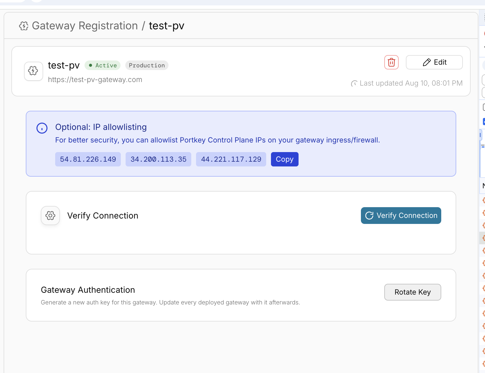
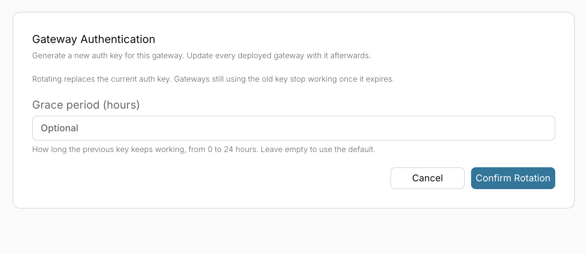
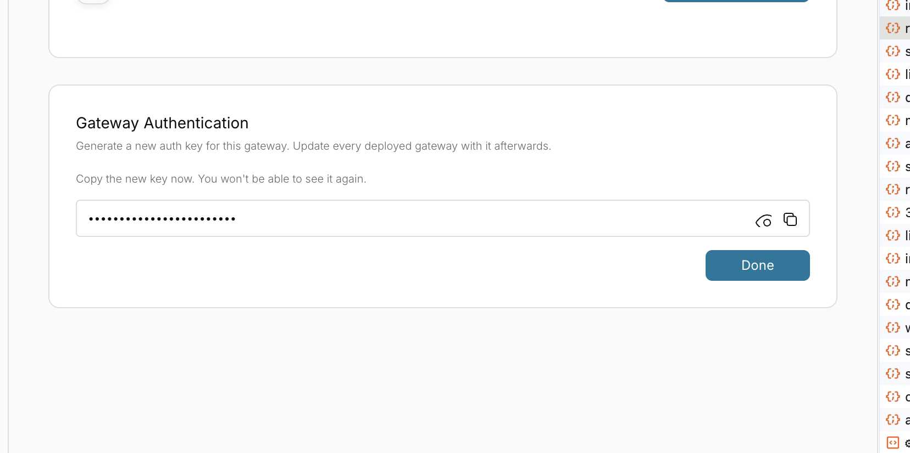

This guide lists every credential that Portkey stores or issues for an organisation, and how to rotate each one. Work through the sections in order.

<Warning>
Portkey does not support grace periods when you replace credentials stored in integrations, providers, MCP servers, or other settings. Saving a new value does not take effect on every gateway at once. Hybrid and self-hosted gateways clear cached keys, integrations, and configs on a sync that runs about once a minute, and values read from a vault are cached for up to 5 minutes. For each credential: create the new value at the source, update Portkey, wait for the change to propagate, confirm requests succeed with the new value on every gateway, then revoke the old value at the source.
</Warning>

## Credentials at a glance

| # | Credential | Where it lives | Rotate at |
|---|---|---|---|
| 1 | [Portkey API keys](#1-portkey-api-keys) (admin, workspace service, workspace user) | Portkey | Portkey |
| 2 | [AI provider credentials](#2-ai-provider-credentials) (integrations, providers, virtual keys) | Portkey | Your AI provider, then Portkey |
| 3 | [MCP credentials](#3-mcp-credentials) | Portkey | The MCP server or IdP, then Portkey |
| 4 | [Secret references](#4-secret-references-and-vault-credentials) | Your vault | Your vault |
| 5 | [JWT, sessions, and users](#5-jwt-sessions-and-users) | Portkey | Your IdP, then Portkey |
| 6 | [Plugin integration credentials](#6-plugin-integration-credentials) | Portkey | The plugin provider, then Portkey |
| 7 | [Credentials embedded in configs, guardrails, and prompts](#7-credentials-embedded-in-configs-guardrails-and-prompts) | Portkey | The upstream service, then Portkey |
| 8 | [Observability and log export credentials](#8-observability-and-log-export-credentials) | Portkey or your gateway | Your destination, then Portkey |
| 9 | [Self-hosted gateway secrets](#9-self-hosted-gateway-secrets) | Your deployment | Your deployment |

## Before you start

- **Use a rotation account you trust.** Sign in to the Portkey dashboard with SSO or your own credentials. Don't depend on an existing API key to run the rotation.
- **Plan for downtime.** Replacing a credential breaks any application still using the old value. Roll out new values to your applications before revoking the old ones.
- **Keep a list.** Record each credential you rotate, so you can confirm none was missed. Use the [checklist](#rotation-checklist) at the end of this page.
- **Know your permissions.** Rotating organisation-level resources requires an organisation owner or admin. Workspace-level resources require a workspace admin or manager.

## 1. Portkey API keys

Portkey issues three kinds of API keys. See [API Keys (AuthN and AuthZ)](/product/enterprise-offering/org-management/api-keys-authn-and-authz) for how they differ.

- **Admin API keys:** organisation-level keys with access across workspaces
- **Workspace service API keys:** workspace-level keys for backends and automation
- **Workspace user API keys:** workspace-level keys owned by individual users

### Choose a rotation method

| Method | Key ID | Old secret | Use when |
|---|---|---|---|
| **Create a new key, then delete the old key** | Changes | Revoked when you delete the key. Gateways can keep accepting it until their cache refreshes (about a minute). | The old key must stop working as soon as possible |
| **[Rotate the key](/product/enterprise-offering/org-management/api-key-rotation)** | Unchanged | Stays valid for the transition period (minimum 30 minutes) | Usage history, budgets, and attribution must stay attached to the same key |

<Note>
The rotate endpoint always keeps the previous secret valid for the transition period, with a minimum of 30 minutes. To end access as soon as possible, create a new key and delete the old one. Gateways cache API keys and clear changed ones on a sync that runs about once a minute, so confirm the old key returns `401` on every gateway, including self-hosted ones, before treating it as revoked.
</Note>

### Rotate with the dashboard

<Steps>
<Step title="Open API Keys">
Go to [**API Keys**](https://app.portkey.ai/api-keys).
</Step>
<Step title="Create a replacement key">
Click **Create**. Select the same type, workspace, scopes, and rate or budget limits as the key it replaces. Also copy its default config and its **Config Override** setting. Without them the new key loses the routing and guardrails attached to the old one, or lets requests override the config.
</Step>
<Step title="Deploy the new key">
Update your applications, CI pipelines, secret stores, and `x-portkey-api-key` headers with the new key.
</Step>
<Step title="Delete the old key">
After traffic moves to the new key, delete the old key from the list.
</Step>
</Steps>

### Rotate with the API

1. [Create an API key](/api-reference/admin-api/control-plane/api-keys/create-api-key) with `POST /v2/api-keys/{sub-type}`. Set the same default config and config-override setting as the old key.
2. Deploy the new key.
3. [Delete the old key](/api-reference/admin-api/control-plane/api-keys/delete-an-api-key) with `DELETE /v2/api-keys/{id}`.

To keep the same key ID instead, call [`POST /v2/api-keys/{id}/rotate`](/api-reference/admin-api/control-plane/api-keys/rotate-api-key). The response contains the new secret and the time the previous secret expires.

### Order of rotation

1. Rotate **admin API keys** first. They can create or modify every other resource.
2. Rotate **workspace service API keys** next. They can manage other workspace keys.
3. Rotate **workspace user API keys** last. Ask each user to replace theirs, or rotate them as an admin.

List existing keys with [`GET /v2/api-keys`](/api-reference/admin-api/control-plane/api-keys/list-api-keys) to find every key to replace. Delete any key you don't recognise or no longer use.

## 2. AI provider credentials

Integrations, providers, and virtual keys hold credentials for your AI providers: API keys, cloud access keys, service account JSON, and similar. Rotating the key only in Portkey does not invalidate the old one. **Rotate the credential at the provider.**

For each integration:

<Steps>
<Step title="Create a new credential at the provider">
Generate a new API key, access key, or service account key in your provider's console.
</Step>
<Step title="Update the credential in Portkey">
In the dashboard, open [**Model Catalog**](https://app.portkey.ai/model-catalog/providers), select the integration, and replace the stored credential. To use the API, call [`PUT /integrations/{slug}`](/api-reference/admin-api/control-plane/integrations/update-integration) or [`PUT /providers/{slug}`](/api-reference/admin-api/control-plane/providers/update-provider).
</Step>
<Step title="Test a request">
Send a test request through a model on the integration to confirm the new credential works.
</Step>
<Step title="Revoke the old credential at the provider">
Delete or disable the old key in your provider's console.
</Step>
</Steps>

### Credentials by provider

| Provider | Credential to rotate |
|---|---|
| OpenAI | API key. Rotate the optional organisation and project IDs only if your provider treats them as secret. |
| Anthropic, Gemini, and other API-key providers | API key |
| AWS Bedrock | AWS access key ID and secret access key. For assumed-role setups, also review the role's trust policy. To rotate an external ID, see [Rotate an external ID](#rotate-an-external-id). See [Connect Bedrock with Amazon Assumed Role](/product/model-catalog/connect-bedrock-with-amazon-assumed-role). |
| Azure OpenAI | API key, or the Entra ID client secret for service principal authentication |
| Google Vertex AI | Service account key. Create a new key, update Portkey, then delete the old key. |
| Custom or self-hosted model endpoints | Any bearer token or custom header value you configured |

<Note>
Integrations that use [workload identity federation](/product/model-catalog/workload-identity-federation) do not store a static provider key, but they do use an identity provider client secret. Create a replacement client secret at the IdP, update it in the integration (or the vault entry it references), send a test request, then revoke the old secret. Also review the trust relationship and allowed subjects on the cloud side.
</Note>

### Rotate an external ID

The role's trust policy checks the external ID in its `sts:ExternalId` condition. Changing the ID only in the integration makes `AssumeRole` calls fail. Rotate it in this order:

1. Add the new external ID to the trust policy's `sts:ExternalId` condition, keeping the old one. A condition value can list more than one ID.
2. Update the external ID in the integration.
3. Wait for the change to propagate, then send a test request through the integration.
4. Remove the old external ID from the trust policy.

### Virtual keys (deprecated)

Existing virtual keys hold provider credentials too. Rotate them the same way using the dashboard or [`PUT /virtual-keys/{slug}`](/api-reference/admin-api/control-plane/virtual-keys/update-virtual-key). Alternatively, migrate to [integrations and providers](/product/model-catalog/integrations) and delete the virtual key.

### Credentials used in requests

If your applications send provider credentials per request, such as an `Authorization` header or `x-portkey-*` provider headers, rotate those in your application secret stores as well.

## 3. MCP credentials

[MCP integrations and servers](/product/mcp-gateway/mcp-registry) store credentials that Portkey uses to reach upstream MCP servers. Rotate each one at the source, then update Portkey.

| Authentication type | What to rotate | Steps |
|---|---|---|
| **Static headers** ([custom auth](/product/mcp-gateway/authentication/custom-auth)) | Bearer tokens, API keys, or custom header values | Generate new credentials on the MCP server. Update the headers on the MCP integration or server in Portkey. Revoke the old credentials. |
| **Client credentials** ([client credentials](/product/mcp-gateway/authentication/client-credentials)) | OAuth client secret | Create a new secret at your IdP. Update **Client Secret** in the integration, or in the vault entry it references. Wait up to 5 minutes for vault-cached values to refresh. Revoke the old secret. |
| **OAuth Auto** ([OAuth](/product/mcp-gateway/authentication/oauth)) | OAuth client secret, if you supplied your own OAuth app. Per-user access tokens. | Create a new client secret in the upstream OAuth app and update the integration. To force users to re-authorise, remove their stored connections with [`DELETE /mcp-servers/{mcpServerId}/connections`](/api-reference/admin-api/control-plane/mcp-servers/connections/delete-mcp-server-connection). |
| **External OAuth or JWT validation** | Introspection client secret, if configured | Rotate the introspection credentials at your IdP and update the integration. JWKS URIs and public keys are not secret. |

Also rotate any tokens the MCP server itself holds for downstream systems. Those live outside Portkey.

Use [`GET /mcp-servers`](/api-reference/admin-api/control-plane/mcp-servers/list-mcp-servers) and [`GET /mcp-integrations`](/api-reference/admin-api/control-plane/mcp-integrations/list-mcp-integrations) to list every server and integration that needs review.

## 4. Secret references and vault credentials

[Secret references](/product/enterprise-offering/secret-references) point to secrets in AWS Secrets Manager, Azure Key Vault, or HashiCorp Vault. Portkey stores the reference configuration, including the auth config it uses to reach your vault. It does not store the secret value itself.

Rotate in this order:

1. **Vault access credentials.** Rotate the credentials in each secret reference's `auth_config` (for example an IAM access key, an Azure client secret, or a HashiCorp Vault token or AppRole secret). Update the reference with [`PUT /v1/secret-references/{id}`](/product/enterprise-offering/secret-references#updating-a-secret-reference). Updates to `auth_config` are merged, so send only the changed fields.
2. **The secrets themselves.** Rotate the secret values in your vault. Gateways cache fetched values for 5 minutes, so the new value takes effect within that window with no change in Portkey.
3. **Revoke the old vault credentials.**

## 5. JWT, sessions, and users

<AccordionGroup>
<Accordion title="JWT authentication">
Portkey validates JWTs using your IdP's public keys, which are not secret. Rotate signing keys at your IdP if you suspect they were exposed, and confirm the JWKS configuration in Portkey is current. See [JWT](/product/enterprise-offering/org-management/jwt).
</Accordion>
<Accordion title="Active sessions and users">
Ask users to sign out and back in. Review [organisation users and pending invites](/product/enterprise-offering/org-management/organizations), and remove any user or invite you don't recognise.
</Accordion>
</AccordionGroup>

## 6. Plugin integration credentials

Plugin integrations store credentials for third-party guardrail and tool providers. Rotate the credential at the provider, then update it in Portkey.

<Steps>
<Step title="Create a new credential at the plugin provider">
Generate a new API key, token, or client secret in the provider's console.
</Step>
<Step title="Update the plugin integration">
Open the plugin in the dashboard and replace the stored credentials. The location depends on the plugin: **Settings > Plugins**, **Admin Settings > Plugins**, or **Settings > Integrations**. Check the plugin's setup page for the exact location.
</Step>
<Step title="Update workspace override credentials">
Some guardrails accept workspace-specific **Override Credentials** that take precedence over the organisation-level integration. Open each guardrail that sets them and replace the values.
</Step>
<Step title="Test">
Send a request that runs each guardrail or plugin, and confirm the check completes.
</Step>
<Step title="Revoke the old credential at the plugin provider">
Wait for the change to propagate, then delete or disable the old credential.
</Step>
</Steps>

| Credential type | What to rotate |
|---|---|
| API key or token | The key or token issued by the plugin provider |
| Cloud access keys | The access key ID and secret access key, or the external ID for assumed-role setups (see [Rotate an external ID](#rotate-an-external-id)) |
| OAuth or client secret | The client secret at the identity provider |
| Custom endpoint or header | Any bearer token or header value set on the integration |

Managed identity and similar setups store no secret.

Raw guardrails defined in JSON can carry a `credentials` object inline. Review those under [section 7](#7-credentials-embedded-in-configs-guardrails-and-prompts) as well.

## 7. Credentials embedded in configs, guardrails, and prompts

Credentials sometimes end up inside saved resources instead of integrations. Review each of the following for static secrets:

- **[Configs](/product/ai-gateway/configs):** provider keys, `Authorization` headers, or custom headers inside targets or `override_params`
- **[Guardrails](/product/guardrails):** API keys or headers for third-party guardrail providers, and webhook URLs, headers, or signing secrets for custom guardrails
- **Prompts and prompt partials:** pasted API keys or tokens in the template text
- **Custom hosts and custom headers:** bearer tokens for private endpoints

For each secret found, rotate it at the upstream service, update the saved resource, and revoke the old value. Prefer [secret references](/product/enterprise-offering/secret-references) over inline values so future rotation happens in your vault.

## 8. Observability and log export credentials

Rotate any credential Portkey uses to write to your systems:

- **OpenTelemetry exports:** authentication headers or tokens for your OTel collector. See [OpenTelemetry](/product/enterprise-offering/otel/otel).
- **Log storage for self-hosted gateways:** object storage access keys, HMAC secrets, or service account keys.
- **Third-party observability integrations** that you configured with a token.

Create the new credential at the destination, update the Portkey configuration, confirm data is arriving, then revoke the old credential.

## 9. Self-hosted gateway secrets

For [hybrid deployments](/self-hosting/hybrid-deployments/architecture), rotate every secret in your deployment configuration:

- **`PORTKEY_CLIENT_AUTH`**: the credential your gateway uses to sync with the Portkey control plane. See [Rotate the gateway client auth key](#rotate-the-gateway-client-auth-key).
- **Log store credentials:** for example `LOG_STORE_ACCESS_KEY` and `LOG_STORE_SECRET_KEY` (S3, GCS HMAC, or Azure storage).
- **Cache and database credentials:** Redis, and any database your deployment uses.
- **Provider keys and other values in your environment files, Helm values, or Kubernetes secrets.**
- **Test keys:** replace the `PORTKEY_API_KEY` and `OPENAI_API_KEY` values from any smoke-test scripts.

Redeploy the gateway after updating secrets and confirm it registers and serves requests.

### Rotate the gateway client auth key

<Steps>
<Step title="Open the gateway deployment">
Go to **Admin Settings > Gateway Registration** and open the deployment.
<Frame>
  
</Frame>
</Step>
<Step title="Rotate the key">
Under **Gateway Authentication**, click **Rotate Key**. Optionally, set a **Grace period (hours)** from 0 to 24. This is how long the previous key keeps working. Leave it empty to use the default. Click **Confirm Rotation**.
<Frame>
  
</Frame>
</Step>
<Step title="Copy the new key">
Copy the new key and click **Done**. The key is shown only once.
<Frame>
  
</Frame>
</Step>
<Step title="Update every deployed gateway and Data Service">
Update `PORTKEY_CLIENT_AUTH` to the new key for every gateway and optional Data Service instance that uses this deployment. If your deployment references a secret store, update the underlying credential while preserving secret references and any other fields in the secret. Restart all consuming services so they load the new key before the grace period ends. Services still using the old key lose control-plane authentication once it expires.
</Step>
</Steps>

## After rotating

1. **Confirm the old credentials fail.** Wait at least a few minutes for gateway sync and caches to refresh, then send a request with each old Portkey API key through every gateway, including self-hosted ones. Expect a `401`.
2. **Test end-to-end.** Send a request through every integration, MCP server, and key path your applications use.
3. **Review audit logs.** Check [audit logs](/product/enterprise-offering/audit-logs) under **Admin Settings > Audit Logs**, or call [`GET /audit-logs`](/api-reference/admin-api/control-plane/audit-logs/list-audit-logs), for unexpected creation of API keys, integrations, users, or configuration changes.
4. **Review request logs and provider usage.** Check [logs](https://app.portkey.ai/logs) and your AI providers' usage dashboards for requests you didn't make.
5. **Review users and workspaces.** Remove any user, workspace member, or workspace you don't recognise.

## Rotation checklist

Copy this list to track progress.

- [ ] Admin API keys replaced; old keys deleted
- [ ] Workspace service API keys replaced; old keys deleted
- [ ] Workspace user API keys replaced; old keys deleted
- [ ] Application secret stores updated with new Portkey keys
- [ ] Every integration and provider credential rotated at the provider, updated in Portkey, and old credentials revoked
- [ ] Virtual key credentials rotated, or virtual keys migrated and deleted
- [ ] MCP integration and server credentials rotated; user connections reset where needed
- [ ] Secret reference vault credentials rotated; secret values rotated
- [ ] Plugin integration credentials rotated, including workspace override credentials
- [ ] Configs, guardrails, prompts, and custom hosts reviewed for embedded secrets
- [ ] OTel and log export credentials rotated
- [ ] Self-hosted gateway secrets rotated; gateway redeployed
- [ ] Old Portkey API keys confirmed to return `401`
- [ ] Audit logs and provider usage reviewed

## Related

<CardGroup cols={2}>
  <Card title="API Key Rotation" icon="rotate" href="/product/enterprise-offering/org-management/api-key-rotation" />
  <Card title="API Keys (AuthN and AuthZ)" icon="key" href="/product/enterprise-offering/org-management/api-keys-authn-and-authz" />
  <Card title="Secret References" icon="vault" href="/product/enterprise-offering/secret-references" />
  <Card title="Audit Logs" icon="clipboard-list" href="/product/enterprise-offering/audit-logs" />
</CardGroup>

import PrismaAirsCta from "/snippets/prisma-airs-cta.mdx";

<PrismaAirsCta />
